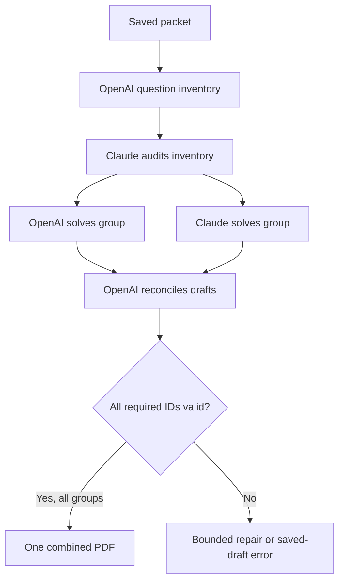

# Glasses Solver: AI handoff and operating guide

Start here when continuing this project. This file records the product intent, current implementation, operating instructions, decisions, and unfinished work; no earlier chat is required.

**Snapshot updated:** 2026-10-19 UTC. **App:** 1.3.1, build 5. **Verified app commit:** `054d1072493522bc446fd0ac45f6ddd7f9537b6b`. Later documentation commits do not imply a new app build. Recheck the branch and CI before relying on this snapshot.

## 1. Find the right branch and read these files

| Item | Where / purpose |
| --- | --- |
| Active app branch | [`solver-app`](https://github.com/Moh-bukhari/glasses-solver/tree/solver-app) |
| Default GitHub branch | `main`; contains the upstream Meta sample baseline and pointers to this guide. The current solver implementation is on `solver-app`. |
| Current draft PR | [PR #1](https://github.com/Moh-bukhari/glasses-solver/pull/1); check its current state before continuing |
| User installation and operation | [SOLVER-SETUP.md](SOLVER-SETUP.md) |
| Repository/SDK instructions | [AGENTS.md](AGENTS.md); the upstream Meta reference follows the Glasses Solver entry point |
| Lessons from actual failures | [tasks/lessons.md](tasks/lessons.md) |
| Current acceptance contract | [tasks/batch-solver-spec.md](tasks/batch-solver-spec.md) |
| Latest crash investigation | [tasks/scan-start-crash-spec.md](tasks/scan-start-crash-spec.md) |
| Historical earlier scan design | [tasks/auto-scan-spec.md](tasks/auto-scan-spec.md); the batch contract and current code supersede single-photo behavior |
| Documentation contract | [tasks/ai-handoff-spec.md](tasks/ai-handoff-spec.md) |

For a fresh checkout:

```bash
git clone --branch solver-app https://github.com/Moh-bukhari/glasses-solver.git
cd glasses-solver
git status --short
git branch --show-current
git log -5 --oneline
```

For an existing checkout, inspect its branch and uncommitted work first. Fetch current remote state and preserve unrelated edits. The repository is derived from Meta's SDK examples: do not confuse `BirdSpotter`, `DisplayAccess`, or generic SDK documentation with this app. The target to develop is `samples/CameraAccess`.

## 2. Product goal and decisions to preserve

The user has an **iPhone, Windows laptop, and Ray-Ban Meta Gen 2 glasses with developer mode**. The desired experience is: start once, look at each paper, follow quiet spoken directions, collect clear close-ups, say that scanning is finished, and receive one worked-solution PDF on the iPhone.

The user originally imported photos from Meta AI into ChatGPT manually. They now want that capture-to-solution workflow automated. A Raspberry Pi was mentioned in the original hardware ideas; it is **not part of the current implementation**. There is no separate Windows/Pi server or hosted solver backend. The iPhone handles coordination, local image analysis and PDF generation, and calls the selected AI APIs directly.

Preserve these decisions when changing the app:

- A usable photo shows the complete problem clearly. It need not look like a flatbed scan: no clean background, four visible paper corners, perfect centering, or automatic perspective correction is required.
- Preview analysis helps choose the first stable close-up. Capture a still and check that still; do not keep waiting indefinitely for an ideal paper outline.
- Forgiving framing must still reject tiny, distant writing and gross blur/darkness. Never increase capture rate by silently weakening the detail check.
- Give specific directions relative to the wearer's camera: left, right, closer, move back, tilt up/down, then hold still. Announce saved pages and AI/PDF progress.
- Collect all pages before solving. A user Finish command is the boundary for solver photo uploads, not the first acceptable frame.
- Use OpenAI, Claude, or both. Both mode must use both configured providers; it must not silently downgrade when a key is missing or one provider fails.
- Complete coverage means every inventoried question/subpart is represented, with worked steps, an answer, and a check. Unresolved issues must be visible. This does not prove that the inventory found every symbol or that an answer is mathematically correct.
- Quiet speech defaults to **5% utterance volume**. This is app speech gain, not a command to set the iPhone/glasses hardware volume.
- Retain saved pages after errors, pauses, or app restarts. Replacing a photo must not destroy the old photo before the new one is saved.

## 3. Current status and evidence

| Area | Status at this snapshot |
| --- | --- |
| Multi-page automatic capture, imports, retakes, draft restoration | Implemented; coordinator/image fixtures pass |
| OpenAI / Claude / both, inventory and answer coverage checks | Implemented; mocked provider/request tests pass |
| One combined PDF, source photos, review flags, history/share | Implemented; PDF coverage/pagination tests pass |
| Directional cues and English on-device commands | Implemented; parser, callback and lifecycle tests pass; real routing/recognition still needs device confirmation |
| 1.3 scan-start app exit | User reported it. 1.3.1 patches a concrete unsafe callback pattern and startup races; exact device crash cause is unconfirmed without a crash report. |
| 1.3.1 iPhone installer | Release build succeeded; archive checksum and bundle/version/permission strings checked |
| Full test evidence | **41 AutoScanTests passed, 0 failures**, including the real Meta mock-device preview-to-full-photo transition |
| Physical glasses and paid API run of 1.3.1 | Not verified in the development environment; do not report as completed |

Evidence: [successful build/test run](https://github.com/Moh-bukhari/glasses-solver/actions/runs/39185371000), [1.3.1 IPA ZIP artifact](https://github.com/Moh-bukhari/glasses-solver/actions/runs/39185371000/artifacts/12157971958). Artifact access may require GitHub login; artifacts can expire. Use the workflow's latest **successful build and verify** results when preparing another download. A newer commit or an IPA from a run with failed tests is not sufficient evidence.

The user previously confirmed that glasses capture and PDF generation could work, but reported incomplete solutions, overly strict framing, and then the scan-start exit. Those reports motivated the changes below; they are not confirmation that the latest full workflow works on the device.

## 4. User workflows

### First-time setup and Windows installation

1. Build/download through [Build Glasses Solver IPA](https://github.com/Moh-bukhari/glasses-solver/actions/workflows/build-solver.yml) on `solver-app`; extract the `GlassesSolver-IPA` ZIP.
2. Use the user's working **iloader** setup on Windows to sign/install `GlassesSolver-unsigned.ipa`. Install over the existing app using the same Apple/signing identity to preserve its container and Keychain access. Do not prescribe another AltStore/SideStore/iTunes setup: earlier authentication attempts caused confusion and iloader is the working route.
3. Pair/configure the glasses in Meta AI, enable developer mode, and complete app registration/camera permission when requested. If Meta says its glasses-side app needs an update but offers no Update button, inspect the actual Meta AI connection/developer-mode state and device software before repeating a menu path. Never assume a button exists.
4. Open Auto Scan settings. Select the provider mode and enter the required API keys **on the device**. Choose model IDs that the account can access and that support the request's image/structured-output format.
5. Allow microphone and speech recognition for hands-free commands. Keep the phone unlocked and the app visible.

No Mac is required for this user route: GitHub's macOS runner compiles the app. A Windows machine by itself does not compile the native iOS target.

### Collect papers, then solve once

1. Tap **Start scanning pages**. In 1.3.1, voice permissions/listening are prepared before the glasses camera starts and before the ready cue.
2. Look at the first page and follow the directional cues. Once a clear close-up stays sufficiently steady, the app captures and checks a still automatically.
3. Wait for **Page N saved**, then turn to the next page. The page-change gate rearms capture; say **next page** if similar-looking pages do not trigger it.
4. Repeat up to 12 photos. Say **retake last page** to replace the latest saved photo. The previous photo remains until the replacement is usable and saved.
5. Say **finish scanning** or **done scanning**, or tap Finish. If a capture/check is already in progress, Finish waits for that photo to be saved.
6. The app announces preparation, question inventory, solving/review, and PDF creation. The combined PDF opens automatically after the full batch succeeds.

**Cancel scanning** works during collection; Pause stops active work and keeps the draft. Finish stops command listening before AI work, while spoken progress continues. To stop solving, use the visible control or leave/background the scan view. The 12-photo limit does not automatically mean the user has finished: Finish is still explicit. Keys are checked at Finish, so collecting pages does not require a configured API key.

### Import, correct, recover

- **Add a paper photo** imports a saved Meta AI/Photos image into the same ordered queue. Importing alone does not solve the packet.
- Pause to use the page queue's Retake, Replace photo, or Remove actions. There is currently no drag-to-reorder interface.
- A failed local still check can retry up to three attempts without calling AI. Existing saved pages remain.
- If AI reports essential content unreadable, use its source-page number to replace that photo and finish again. Retrying a batch repeats its AI requests and may incur additional usage.
- Saved PDFs are available in the PDFs tab and can be shared. **New batch** clears the draft after confirmation, while finished PDFs remain.

### Foreground and voice limitations

Auto-lock is temporarily disabled during work and restored afterward. Backgrounding pauses active work and keeps saved pages, except while the coordinator is connecting to allow initial permission/Meta handoff. Leaving the scan view also stops active work. This is not a locked-phone/background capture service.

Speech recognition uses on-device `en-US` only. If permissions, language support, or recognizer availability are missing, touch controls remain available; there is no cloud transcription fallback. Audio route changes/interruption can stop commands while leaving scanning active. Pause/resume attempts to restore commands. Spoken cues and the command-listening toggle are separate controls.

## 5. How the capture workflow works

`AutoScanModel` is the MainActor coordinator. It holds a per-run ID so old callbacks/tasks cannot modify a newer run. Its phases are:

| Phase | Work / next step |
| --- | --- |
| `idle` | Ready, paused, or imported photos awaiting Finish |
| `connecting` | Prepare voice, wait for a connected device, request camera permission, start SDK camera; app registration is a separate setup action |
| `seeking` | Analyze throttled preview frames and accumulate a stable close-up |
| `capturing` | Request/receive a still; report transfer progress |
| `checking` | Normalize/check the still, then save it or request another attempt |
| `awaitingNext` | Announce the saved page; wait for a changed page or Next command |
| `solving` | Upload the saved packet and run the AI stages |
| `saving` | Build and save the combined PDF and source files |
| `finished` | Present the PDF; retain the draft until New batch |
| `failed` | Show an actionable error; retain saved pages |

`AutoScanCamera` owns Meta SDK `DeviceSession`, Camera, Stream and Photo lifecycles plus listener token bags. Preview is raw/high at 7 fps. The full-photo path stops the stream, starts Photo, requests full/high capture, waits for transfer, and stops Photo. Only unsupported photo setup (`serviceUnavailable` or `sessionSetupFailed`) uses the existing stream-photo fallback. Do not replace SDK state waits with arbitrary sleep delays.

`PageAnalyzer` runs away from MainActor and uses Vision text rectangles/character boxes to locate likely writing, not OCR transcription. It favors the connected writing group near the center. Temporary analysis crops are for metrics only; saved/submitted photos preserve the full composition.

Important code-owned tuning values in `ScanQuality.swift` and `AutoScanModel.swift`:

| Gate | Current behavior |
| --- | --- |
| Preview analysis | At most once per 0.33 seconds; one analysis task in flight |
| Close-up | Detected median text height at least 10 image pixels; region too small when width <0.18 **and** height <0.14 of image |
| Gross quality veto | Luminance <0.07, contrast <0.018, or sharpness <0.00012 |
| Stable hold | 1.5 seconds for the hold cue; otherwise 3 seconds; at least 5 samples, reset on movement/long gaps |
| Missing text outlines | Stable central detail can still capture handwriting/diagrams; no paper-outline prerequisite |
| Page turn | At least 2 seconds after the captured preview was latched, then 3 consecutive changed usable frames after preview resumes; text-region fingerprint threshold 0.065, full-frame fallback 0.20 |
| Guidance repetition | Direction debounce; first useful/hold cue can speak promptly, changed directions after 2.2 seconds, repeats after 7 seconds |
| Original photo preparation | Up to 60 megapixels; orientation-normalized JPEG at 0.95 quality; reject prepared files at or above 20 MB |

These are heuristics. The implementation chooses the first acceptable stable view; it does not rank a continuous photo burst or prove every character is readable. Page-change detection is visual, not semantic duplicate detection. Tune against actual problematic photos, including cluttered backgrounds, instead of repeatedly tightening rectangle detection.

## 6. What OpenAI and Claude actually do

The default saved-settings mode is `both`. The bare `SolverConfiguration()` type defaults to OpenAI; tests may construct it directly. Read `SolverKeychain.configuration()` for user-facing defaults.

In both mode:



Each AI stage receives **all source photos**, even when working on a group of at most six subparts, so shared diagrams and definitions remain available. This is a fixed, bounded sequence of requests, not an open-ended agent debate:

1. OpenAI assesses every source page and creates a stable-ID question/subpart inventory with original labels, full transcriptions and source-page references.
2. Claude audits that inventory against the photos, preserves existing IDs, corrects text, and adds omitted items.
3. For each group, OpenAI and Claude solve independently in parallel.
4. OpenAI receives both drafts and reconciles them against the original photos. Claude receives OpenAI's inventory, but does **not** receive OpenAI's answer draft in the current implementation.
5. The app validates exact ID coverage and nonempty steps/answer/check. Every group must finish before the PDF is created.

Single-provider mode uses its selected provider for inventory, solving each group, and a separate review of its own draft. Neither mode is guaranteed to produce the mathematically best answer.

### Output contracts and error handling

- Inventory: `title`, one `pages` assessment per source, and `questions` containing `id`, `label`, `sourcePages`, `problem`.
- Answers: `answers` containing `id`, `steps`, `answer`, `check`, `status`, `reviewNote`.
- Allowed statuses: `solved`, `needs_review`, `insufficient_information`. Non-solved items require an explanation and are printed as **NEEDS REVIEW**. Such explicitly flagged items may appear in a completed PDF; a missing required answer or failed stage may not.
- Inventory validation rejects omitted/duplicated page assessments, unreadable essential content, missing references, duplicate IDs, and more than 60 subparts. It cannot detect a question that both models silently omitted.
- Malformed/empty/truncated output or structural coverage mistakes get **one repair per stage**, with larger output allowance. Authentication, network, rate-limit, service errors and refusals are not automatically retried as formatting problems.
- Missing essential image content stops with page-specific retake instructions. Do not fabricate symbols or a partial success PDF.
- Cancelling invalidates late results and blocks subsequent stages/saves. Requests already accepted by a provider may still incur usage.
- Model prompts treat photo text and draft answers as untrusted document content, not instructions to the app.

### Provider transport and limits

| Item | Current implementation |
| --- | --- |
| OpenAI | `https://api.openai.com/v1/responses`; Bearer key; image detail high; strict JSON schema; `store: false` |
| Claude | `https://api.anthropic.com/v1/messages`; `x-api-key`; `anthropic-version: 2023-06-01`; base64 JPEG; structured JSON output config |
| Editable model defaults | OpenAI `gpt-5.4`; Claude `claude-sonnet-5-5`. These are app defaults, not a promise of current account availability. |
| Batch bounds | 1–12 photos, at most 60 inventoried subparts, groups of at most 6 |
| Upload image copies | At most 2576 pixels on long edge, up to 1.5 MB JPEG each; whole composition retained; full originals kept locally |
| Request/output bounds | JSON body <30,000,000 bytes; initial 16,000 output tokens, repair 24,000; request timeout 300 seconds, resource timeout 360 seconds |
| Normal request count | Both: `2 + 3 × ceil(subparts / 6)`, at most 32. Single: `1 + 2 × ceil(subparts / 6)`, at most 21. Repairs can at most double these counts. |

Verify vendor documentation and account access before changing endpoints, schemas, model IDs or limits. Large packets and both-provider review can take longer than the user's original couple-minute goal. Model calls are paid API usage; a chat-app subscription alone is not configured as the app's API credential.

## 7. Code map and ownership

All paths below are relative to the repository root.

| File | Responsibility / key types |
| --- | --- |
| [CameraAccessApp.swift](samples/CameraAccess/CameraAccess/CameraAccessApp.swift) | App entry; `Wearables.configure()`; debug mock support |
| [MainAppView.swift](samples/CameraAccess/CameraAccess/Views/MainAppView.swift) | Auto Scan / Glasses / PDFs tabs |
| [AutoScanView.swift](samples/CameraAccess/CameraAccess/Solver/AutoScanView.swift) | Controls, page queue, imports, settings sheet, foreground handling; `SolutionViewer`, `PDFPreview`, `SolutionHistoryView` |
| [AutoScanModel.swift](samples/CameraAccess/CameraAccess/Solver/AutoScanModel.swift) | Capture/batch state machine, run IDs, Finish boundary, cancellation, progress and voice cues |
| [AutoScanCamera.swift](samples/CameraAccess/CameraAccess/Solver/AutoScanCamera.swift) | `ScanCamera`, SDK lifecycle, full still transfer and stream fallback |
| [ScanQuality.swift](samples/CameraAccess/CameraAccess/Solver/ScanQuality.swift) | `PageAnalyzer`, `PageSample`, `ContentFraming`, `StabilityGate`, `PageTurnGate`, `GuidanceSpeechGate` |
| [ScanVoice.swift](samples/CameraAccess/CameraAccess/Solver/ScanVoice.swift) | `ScanSpeaking`, `ScanCommand`, native speech/listening, Sendable callback bridge, startup identities |
| [ScanDraft.swift](samples/CameraAccess/CameraAccess/Solver/ScanDraft.swift) | `CapturedPage`, `ScanDraftStore`, atomic ordered local queue |
| [BatchSolver.swift](samples/CameraAccess/CameraAccess/Solver/BatchSolver.swift) | Provider config, `SolverClient` HTTP transport, schemas, inventory/answer validation, `BatchSolver` orchestration |
| [SolverService.swift](samples/CameraAccess/CameraAccess/Solver/SolverService.swift) | Result types, `SolutionStore`, `SolutionPDF`, persistence and rendering |
| [SolverView.swift](samples/CameraAccess/CameraAccess/Views/SolverView.swift) | `SolverKeychain`, settings, import-only wrapper |
| [Info.plist](samples/CameraAccess/CameraAccess/Info.plist) | Permission strings, Meta callback/config, file sharing and background declarations |
| [project.pbxproj](samples/CameraAccess/CameraAccess.xcodeproj/project.pbxproj) | App/test targets, versions, package pin, explicit source build entries |
| [AutoScanTests.swift](samples/CameraAccess/CameraAccessTests/AutoScanTests.swift) | Scanner/voice/batch/API/PDF regression tests and fixtures |
| [build-solver.yml](.github/workflows/build-solver.yml) | Cloud verification, unsigned Release build and IPA artifacts |

When adding Swift files, include them in the Xcode project's appropriate source build phase; a file existing on disk does not automatically compile. Preserve Swift 6/MainActor boundaries, async SDK operations, listener retention, and bounded state waits. Use injected `ScanCamera`, `PageAnalyzing`, `ScanSpeaking`, `BatchSolving`, `AITransport`, `SolutionSaving` seams for targeted tests, while retaining real integration checks where mocks would hide a failure.

## 8. Data, credentials and PDF behavior

| Data | Location / behavior |
| --- | --- |
| Ordered draft | `Documents/ScanDraft/pages.json`, an array of page UUIDs; matching `<UUID>.jpg` files |
| Draft writes | Atomic image/manifest writes with complete file protection; replace manifest before deleting an old image |
| Finished packet | `Documents/Solutions/<UUID>/Solution.pdf`, `Solution.json`, `Paper.jpg`, `Paper-2.jpg`, etc. |
| Files app | On My iPhone → Glasses Solver → Solutions |
| OpenAI key | Keychain service `GlassesSolver`, account `OpenAI`; preserve this existing account on upgrade |
| Claude key | Same service, separate account `Anthropic` |
| Key protection | `kSecAttrAccessibleWhenUnlockedThisDeviceOnly`; never put keys in prompts, source, logs, GitHub, or this guide |
| Preferences | `solverMode`, `solverModel` (OpenAI), `claudeModel`, `voiceCommands`, `voiceGuidance`, `cueVolume` in app settings/UserDefaults |

Keys go only to their matching provider's authentication header. In both mode the packet is sent to both providers, and model-generated inventory/drafts are shared as described above. Local preview analysis and command recognition do not use a cloud solver. **No solver photo upload occurs until Finish**; that is not a claim that the app/Meta SDK makes no earlier network requests or collects no SDK telemetry. This app has not added a Meta analytics opt-out configuration. `store: false` is not a blanket guarantee about provider data retention.

PDF rendering uses native UIKit/CoreText/PDFKit support and readable Unicode/plain-text math, not a LaTeX engine. It includes the inventory coverage summary, source-page references, worked answers/checks, review notes, and every source photo. The renderer keeps headings with their text, paginates long solutions, limits the solution text to 100 pages, and uses downsampled source previews; full prepared JPEG originals remain alongside the PDF. Do not silently truncate a solution to make it fit.

## 9. Build, test and distribute

Current project: **Meta SDK exact 1.0.1**, Swift language mode **6.0**, minimum **iOS 17.2**. CI uses `macos-26`, `/Applications/Xcode_26.4.app/Contents/Developer`, and the **iPhone 17 Pro / iOS 26.4.1** simulator destination. The simulator runtime patch version matters; check actual destinations before changing it.

On a compatible Mac, from the repository root, use the workflow as the source of truth. Equivalent test command:

```bash
xcodebuild test \
  -project samples/CameraAccess/CameraAccess.xcodeproj \
  -scheme SolverTests -configuration Debug \
  -destination 'platform=iOS Simulator,name=iPhone 17 Pro,OS=26.4.1' \
  -only-testing:CameraAccessTests/AutoScanTests \
  -parallel-testing-enabled NO -resultBundlePath TestResults.xcresult \
  -test-timeouts-enabled YES -default-test-execution-time-allowance 90 \
  CODE_SIGN_IDENTITY="-" CODE_SIGNING_ALLOWED=YES CODE_SIGNING_REQUIRED=YES \
  DEVELOPMENT_TEAM=""
```

Use a new result-bundle path if that output already exists. **Simulator tests need ad-hoc signing** because Meta initializes a Keychain access group. Do not apply the unsigned-device flags to the simulator tests.

Unsigned device build:

```bash
xcodebuild \
  -project samples/CameraAccess/CameraAccess.xcodeproj \
  -scheme CameraAccess -configuration Release -sdk iphoneos \
  -destination 'generic/platform=iOS' -derivedDataPath build \
  CODE_SIGNING_ALLOWED=NO CODE_SIGNING_REQUIRED=NO build
```

The workflow places `CameraAccess.app` inside `Payload/` and zips it as `GlassesSolver-unsigned.ipa`; iloader supplies installation signing. Keep app bundle ID **`com.mohbukhari.glassessolver`** unless intentionally migrating data/signing. Update marketing/build versions for app releases and verify them inside the packaged `Info.plist`.

Cloud workflow details:

- Pushes to `solver-app` touching `samples/CameraAccess/**` or the workflow trigger independent `verify` and `build` jobs. Manual `workflow_dispatch` is also available.
- Root documentation-only commits do not trigger this IPA workflow. Do not claim a new app test just because documentation was published.
- Artifacts: `GlassesSolver-IPA`, `build-log`, `test-results` (test logs, xcresult and exported attachments).
- Inspect both job conclusions, actual test counts/failures and the matching commit. Builds may finish before simulator startup/testing.
- The workflow selects only `CameraAccessTests/AutoScanTests`, not the entire upstream unit/UI suite. These tests cover quality/stability, forgiving framing, voice commands/callbacks/permission races, queue/Finish/cancellation, Meta mock full-photo capture, provider request/response contracts and separation, bounded repair, coverage and PDF pagination.
- The voice callback regression invokes the production closures with a synthetic PCM buffer on a background queue. It does not activate microphone input or perform actual speech recognition. Most coordinator tests use injected fakes.
- The Meta integration test waits up to 20 seconds for a real mock preview frame, then requests the full photo. Do not remove the frame assertion to make cold simulator failures pass.
- Paid API calls, physical camera optics, Bluetooth microphone routing, spoken-command accuracy and arbitrary math correctness are **not** validated by these tests.

For a code change, validate the relevant risk, run the required suite/build, then publish an installer tied to that commit. For a docs-only change, check links/content/diff without rebuilding unchanged app code. When GitHub connectors are used instead of local push, create the tree/commit with the current parent and update the branch with an expected-head check; refetch if another edit moved the branch. Do not force-push over other work or merge the draft PR as an incidental documentation step.

## 10. Troubleshooting and unresolved work

| Symptom | Where to investigate / next useful evidence |
| --- | --- |
| App exits immediately on Start | Confirm installed version/build. 1.3.1 patched voice callback actor isolation and stale permission starts. If it still exits, obtain the iPhone crash report and exact timing relative to permission/ready cues; do not keep guessing. Turning off Hands-free voice commands can isolate the listener while retaining spoken cues. |
| Swift executor assertion on an audio callback | See `ScanVoice.makeAudioTap`, `makeRecognitionHandler` and explicit Sendable permission/notification closures. Audio callbacks must not inherit MainActor execution or mutate UI directly. The regression invokes actual production callbacks on a background queue. |
| Voice commands stop after route change/call | Inspect `ScanVoice` notification handling; current behavior intentionally falls back to touch controls. Pause/resume to prepare listening again. Actual Bluetooth recovery remains a device test. |
| Holds forever / asks for clear background | Inspect the real preview and `PageSample`: closeEnough, issue, cue, bounds, text size and stability. No rectangle/background prerequisite should be introduced. Use the source photo, not only a screenshot of the UI, to assess readability. |
| Same page captured repeatedly / next page missed | Inspect PageTurnGate and content fingerprints. Similar layouts can require explicit Next page. It is not semantic duplicate detection. |
| Partial, empty or truncated answer | Inspect source photos, inventory IDs/page references, provider envelope/stop reason, repair attempts and answer coverage. Do not classify it as a scan failure without evidence. Never log keys/base64 photos while investigating. |
| HTTP 400/404 or model rejected | Check editable model ID and that account/model's vision and structured-output support. Defaults are not guaranteed access. |
| HTTP 401/403/429 | Check the relevant key/access or rate/credit limit on the device; keep draft; no blind retries. |
| Full-photo transfer fails | Inspect session/stream/photo states and error type in AutoScanCamera. Preserve stop/start/transfer sequencing and bounded waits. |
| Meta says glasses-side app needs update | Inspect Meta AI app connections, developer mode and actual update availability; user previously saw only Disconnect. |
| Missing simulator destination / Keychain failure | Match installed runtime exactly; retain ad-hoc test signing. See lessons and workflow. |
| PDF cuts off content or strands headings | Inspect SolutionPDF pagination and extracted final-step/source-photo markers. Render affected fixtures for visual review. |

Next priorities, **not completed claims**:

1. Confirm on the user's iPhone that 1.3.1 starts scanning without the reported exit; collect a crash log if it fails.
2. Run a two-page device acceptance test: directional cues → hold → saved-page announcement → next/retake → Finish → progress → one PDF containing both complete questions and both sources. Also pause/reopen to confirm restoration.
3. Check both APIs with real account/model access and a small known-answer packet. Compare actual image text, inventory and final answers. Fixture success alone is insufficient.
4. Evaluate dense math, tiny exponents, diagrams, clutter, tilt and similar page layouts from real photos; tune only against observed misses.
5. Test quietness, speech self-trigger suppression, microphone route changes and interruptions with physical glasses.
6. Reassess latency/cost and PDF math formatting if they remain a user problem. Background operation, a Raspberry Pi/backend, richer LaTeX rendering, semantic deduplication, and arbitrary multi-round model debate are not implemented commitments.

Do not expand these ideas into new features without a current task that calls for them.

## 11. How the next AI should work and leave a handoff

1. Read this guide, relevant specs and lessons; inspect current code/branch/status. The latest user request and actual evidence determine the task. This snapshot is not permission to ignore newer requirements.
2. For substantial changes, write/update a short acceptance spec and plan, then inspect the actual responsible files. Preserve working Meta connection and capture behavior while testing the affected area.
3. Keep keys, Apple credentials, personal paper images and tokens out of source/docs/logs. Store API keys through the existing on-device Keychain UI. Use fixtures for development; run paid live tests only when authorized by the user's task and credentials are configured.
4. Verify the behavior, not merely compilation. Use a real callback or SDK integration where a fake would hide the bug. Keep run IDs/cancellation and failure retention intact.
5. Before calling an app release ready, record exact commit, version/build, CI link, test count/failures, artifact, and what still needs hardware/API confirmation. Provide the user a direct download and short installation steps.
6. After changes, update this guide's snapshot, relevant workflow/limits/code map, known issues and next priorities. Keep SOLVER-SETUP aligned with user-visible behavior. Add a concrete lesson when user feedback reveals an incorrect assumption.
7. Keep `main` entry points directed at this canonical guide until the app branch changes or merges. Keep AGENTS/CLAUDE as entry points rather than maintaining competing copies of the architecture.

Useful primary references: [Meta developer docs](https://wearables.developer.meta.com/docs/develop/), [bundled Meta skills](plugins/mwdat-ios/skills), [Apple callback-isolation diagnosis](https://developer.apple.com/forums/thread/793455), [OpenAI Responses/vision docs](https://developers.openai.com/api/docs/guides/images-vision), [Claude vision docs](https://platform.claude.com/docs/en/build-with-claude/vision), [Claude structured outputs](https://platform.claude.com/docs/en/build-with-claude/structured-outputs). Use current official documentation when changing vendor integration behavior.
