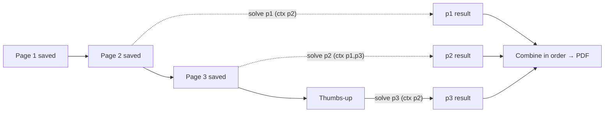

# Glasses Solver: AI handoff and operating guide

Start here when continuing this project. This file records the product intent, current implementation, operating instructions, decisions, and unfinished work; no earlier chat is required.

**Snapshot updated:** 2026-10-20 UTC. **App:** 2.7, build 13 (manual photo import, both AIs on every page, fx-CG50 calculator pictures; see "Photos to PDF and calculator pictures (2.7, default)"). The 2.7 CI run is recorded in the commit history after the 2.7 commit. The Linux harness passes 97 coordinator, frame and calculator tests and 28 solver tests; a Swift-written .g3p decodes in an independent Python decoder, and the .g3p container matches Casio's `_Blank.g3p` byte for byte. Not yet checked on a real fx-CG50 or with live keys. Previous: 2.6, build 12 (pages photographed with the glasses' capture button, checked as they arrive, solved as you go, one folder per packet; see "Glasses photos with the capture button (2.6, default)"). 2.6 first push `8aebb35` (CI run 39340425199 green), then two review rounds: `40a55d6` (one reviewer, 4 fixes; CI run 39342775676 green, IPA artifact 12229862161) and a 4-lens review with 2 skeptics per finding (18 reported, 10 confirmed, 9 distinct fixes in the following commit, whose CI run is recorded in the commit history). The Linux harness passes 88 coordinator and frame tests (20 photo-flow tests; the 9 regression tests fail without their fixes) and 28 solver tests. Not yet checked on the device; the Meta AI import delay while the glasses are worn is the main unknown. Previous: 2.5, build 11 (best models with paid speed lanes; see "Best models and paid speed lanes (2.5)"). 2.5 head `352346f`: CI run 39327006434, build and verify green, IPA artifact 12222004640 (sha256 `6240ace2…`). The Linux harness passes (68 coordinator and 51 solver/gesture tests). A 2-lens adversarial review of the speed-lane change found 7 issues, all fixed in `352346f`. Not yet checked on the device or with live keys. Previous: 2.4, build 10 (page-by-page AI check, solve after 👍; see "Page-by-page AI check (2.4)"). 2.4 head `2e189f4`: CI run 39254268214, build and verify green, IPA artifact 12186926575 (sha256 `4ba265f5…`). The previous 2.4 head `b420e3c` passed build and all simulator tests (run 39252054488). The Linux harness passes for `2e189f4` (68 coordinator and 48 solver/gesture tests). The test job now picks whichever iPhone simulator the runner has (`601f7a3`), because the image dropped iPhone 17 Pro / iOS 26.4.1. Not yet checked on the device. Previous: 2.3, build 9 (pages named by question, typeset PDF math). 2.3 head `5a7c435`: CI run 39239667127, build and verify green (131 iOS tests, 0 failures, including the SwiftMath PDF test), IPA artifact 12180468381 (sha256 `6bfb491b…`). The Linux harness also passes (62 coordinator, 45 solver/gesture and 10 math tests). Not yet checked on the device. Previous: 2.2, build 8 (live multi-frame capture). 2.2 head `472bce9`: CI run 39230811663 build green, IPA artifact 12176689395 (sha256 `2a9220bb…`); its test job was not awaited because the user chose to test on the device. The previous 2.2 commit `ec1e752` passed build and tests (run 39229059366). The 2.1 evidence below is the last full release check, on branch `claude/pensive-allen-ggkllj`, which is based on `solver-app`. **Verified app commit:** `3129449` (CI run 39203283744, build and verify green, 100 tests, 0 failures). 2.0 was verified at `f963ee9` (run 39197936367, 89 tests). Later documentation commits do not imply a new app build. Recheck the branch and CI before relying on this snapshot.

## 1. Find the right branch and read these files

| Item | Where / purpose |
| --- | --- |
| Active app branch | All 2.x work (2.0 to 2.7) is on [`claude/pensive-allen-ggkllj`](https://github.com/Moh-bukhari/glasses-solver/tree/claude/pensive-allen-ggkllj). 1.3.1 and earlier are on [`solver-app`](https://github.com/Moh-bukhari/glasses-solver/tree/solver-app). Merge or retarget as the user decides. [README.md](README.md) is the short overview. |
| Default GitHub branch | `main`. It holds the upstream Meta sample baseline and pointers to this guide. |
| Earlier draft PR | [Moh-bukhari/glasses-solver#1](https://github.com/Moh-bukhari/glasses-solver/pull/1). Check its current state before continuing. |
| User installation and operation | [SOLVER-SETUP.md](SOLVER-SETUP.md) |
| Repository and SDK instructions | [AGENTS.md](AGENTS.md). The upstream Meta reference follows the Glasses Solver entry point. |
| Lessons from actual failures | [tasks/lessons.md](tasks/lessons.md) |
| **Current acceptance contract** | [tasks/handsfree-gesture-spec.md](tasks/handsfree-gesture-spec.md) (2.1 controls), on top of [tasks/one-button-gesture-spec.md](tasks/one-button-gesture-spec.md) (2.0 capture, solving, PDF) |
| Superseded contracts | [tasks/batch-solver-spec.md](tasks/batch-solver-spec.md) (1.3 batch pipeline) and [tasks/auto-scan-spec.md](tasks/auto-scan-spec.md) (single photo) |
| Earlier crash investigation | [tasks/scan-start-crash-spec.md](tasks/scan-start-crash-spec.md) |
| Documentation contract | [tasks/ai-handoff-spec.md](tasks/ai-handoff-spec.md) |

For an existing checkout, inspect its branch and uncommitted work first, fetch the current remote state, and preserve unrelated edits. The repository is derived from Meta's SDK examples, so don't confuse `BirdSpotter`, `DisplayAccess` or generic SDK documentation with this app. The target to develop is `samples/CameraAccess`. BirdSpotter is still a useful reference for Inputs and Motion usage.

## 2. Product goal and decisions to preserve

The user has an **iPhone, a Windows laptop, and Ray-Ban Meta Gen 2 glasses with developer mode** (camera, open-ear speakers, touchpad, capture button, no display). The desired experience:

- Start with **one button or a phone shortcut** (Action button, Back Tap, Control Center, Siri), then look at each page.
- The app captures each page when it has a good view.
- **Never take out the phone** during a packet: hand gestures only. 👍 start solution, 👉 next page, 👈 (or 👎) previous page. The glasses buttons did not work for the user.
- One worked-solution PDF arrives on the iPhone **fast**.
- Control is **silent**: gestures, not voice. The app still gives every instruction needed.
- The user asked for **GPT-6.1 Sol** for OpenAI and **Claude Opus 5.5** for Claude, and doesn't mind which provider is used.

There is no Windows, Raspberry Pi or hosted backend. The iPhone coordinates capture, analyzes images locally, calls the AI APIs directly, and generates the PDF.

Preserve these decisions:

- **Usable photos.** A usable photo shows the complete problem clearly. Don't require a clean background, all four corners, centering, or perspective correction.
- **Readability gates.** Forgiving framing still rejects tiny, distant writing and gross blur or darkness. Never raise the capture rate by weakening the detail check.
- **Directions.** Give specific directions relative to the wearer's camera, then "hold still". Announce the shutter ("Got it"), saved pages, and solving/PDF progress.
- **Gestures are the controls.** On-device hand gestures: a fist with the thumb up (finish), right (next page or take this page now), left or down (previous page: retake the page just saved; repeat to step back). The screen still works. Glasses buttons (experimental Meta Inputs) are an opt-in that defaults off, because they did not reach the app on the user's glasses. Voice commands stay optional and off by default.
- **Hands-free recovery.** Nothing that happens during a camera scan may require the phone. An unreadable page is asked for again through the glasses after Finish (👍 solves without it), a solve failure waits with the camera on for 👍 to retry, and a middle-page retake keeps the camera on and waits for 👉. Retakes of a page not in view capture only after the view changes.
- **Reserved touchpad gestures.** A single tap and tap-and-hold belong to the glasses: they pause/resume and stop the session. Never ask the user to single-tap as a command.
- **Silent audio.** Speech runs at 5% utterance gain through the glasses/Bluetooth route only, by default, using the `.playback` category so the Silent switch doesn't mute it.
- **Speed first.** Solve each page with one streaming request, with its previous and next pages as context, and start while scanning (option "Solve pages while scanning", on by default). This intentionally replaces the 1.3 rule "collect everything, upload only after Finish". The setting restores upload-at-Finish behavior.
- **One provider by default; never a silent downgrade.** Cross-check mode uses both providers and must not quietly fall back when a key is missing or one provider fails.
- **Coverage.** Each page answer includes a checklist of every visible label. Every label is solved or explicitly skipped as belonging to the previous page. Unresolved items show as NEEDS REVIEW. This is not proof of mathematical correctness.
- **No silent partial PDFs.** A failed page stops PDF creation with page-specific retake or retry instructions. Solved pages stay cached, and a retry re-solves only the failed ones. The only exception is the wearer's explicit 👍 while asked for an unreadable page: that page is left out and shown in the PDF as a NEEDS REVIEW placeholder with its photo.
- **Draft retention.** Saved pages survive errors, pauses and app restarts, and a replacement never deletes the old photo first. After a successful PDF the packet stays and is marked solved (`ScanDraft/solved`), so one page can be retaken and the PDF rebuilt from cached answers. Start, or a new photo, begins a new packet. The originals are also copied into the Solutions folder.
- **Lock-safe drafts.** Draft files use until-first-unlock file protection, and 1.x drafts are migrated on load, so solving and PDF creation survive a locked phone.

## 3. Current status and evidence

| Area | Status at this snapshot |
| --- | --- |
| One-button capture, shutter cue, overlapped still check, per-frame analysis | Implemented; coordinator tests pass in simulator CI |
| Hand gestures (thumb up/right/left/down) | Implemented in 2.1. The classifier and timing gate pass 24 Linux fixture tests (26 in Xcode with the Vision cases); coordinator gesture tests pass. Thresholds and the unmirrored-camera assumption (image right = wearer's right) are untested on real egocentric frames. |
| Hands-free recovery (unreadable page re-ask, solve-failure standby, middle-page retake hold, step-back retakes) | Implemented in 2.1 with coordinator tests. Not yet tried on glasses. |
| Start shortcut (App Intent, `glassessolver://scan`) | Implemented in 2.1. CI checks that the App Intents metadata in the built app contains `StartScanIntent`. Registration for a sideloaded app and the Action button / Back Tap setup are **unverified on a device**. |
| Glasses buttons (Meta Inputs, experimental) | Implemented but **off by default** in 2.1 (the user reported buttons don't work). Mapping unit tests and the mock-glasses activation test remain. |
| Per-page streaming solving, retries, repair, cache, cross-check | Implemented. The Claude and OpenAI SSE parsers, retry and repair bounds, and request bodies are covered by tests. **No paid live API call has been made.** |
| Default migration to `gpt-6.1-sol` / `claude-opus-5-5` | Implemented and tested |
| PDF | JPEG-backed source previews decoded off the main actor; coverage summary; up to 300 solution pages |
| Glasses photos via Meta AI import (2.6 default) | Implemented with 10 coordinator tests (fake photo library and checks) and 2 check tests. PhotoKit watching, Full Access handling and the import delay while the glasses are worn are **unverified on a device**. |
| Physical glasses, real gestures, audio routing, live API latency and accuracy | **Not verified** in the development environment |

Evidence:

- **CI run (2.1).** [Run 39203283744](https://github.com/Moh-bukhari/glasses-solver/actions/runs/39203283744) on `3129449`. Both jobs passed: **100 tests, 0 failures**. The build job also confirmed that the App Intents metadata in `CameraAccess.app` contains `StartScanIntent`.
  - AutoScanTests: 51. These include the 2.1 hands-free flows and the Meta mock-glasses test (preview frames, Inputs activation and button mapping, touchpad pause/resume notices, the full-resolution photo).
  - HandGestureTests: 26. PageSolvingTests: 21. GlassesInputTests: 2.
- **IPA artifact (2.1).** `GlassesSolver-IPA` (ID 12164696360, sha256 `db2416df…`) [from that run](https://github.com/Moh-bukhari/glasses-solver/actions/runs/39203283744/artifacts/12164696360). Artifacts expire 2027-01-17.
- **2.0 evidence.** [Run 39197936367](https://github.com/Moh-bukhari/glasses-solver/actions/runs/39197936367) on `f963ee9`: 89 tests; IPA artifact 12162622480.
- **Mock probe.** The Meta mock reports "Critical error, the stream should end" when the stream restarts after a full photo, so the app falls back to a full reconnect; see priority 5.
- **Later runs.** Check later runs on this branch before installing a newer commit. A run counts only when both jobs passed and its head SHA matches the commit.
- **Linux.** The logic-only suites (24 gesture, 20 page-solving) and 40 image-free coordinator tests also pass on Linux under Swift 6.3. That is supporting evidence, not a replacement for CI.
- **Review.** 2.0: an adversarial multi-lens review (compile, coordinator, SDK, pipeline, tests, requirements) was run, and every confirmed finding was fixed. 2.1: a review (compile, coordinator, hands-free walkthrough, gestures, tests) was started but stopped at the user's request before its findings were verified, so none were acted on. Re-run it if more assurance is needed before a device test.

History: the user confirmed that 1.x glasses capture and PDF generation worked. They then reported that **"solving" never produced a PDF**. The cause was the latency of a sequential, non-streaming multi-stage pipeline (§6), not a deadlock.

## 4. User workflows

### Setup (Windows, no Mac)

1. Download the `GlassesSolver-IPA` artifact from a green run of the workflow on the 2.0 branch.
2. Install `GlassesSolver-unsigned.ipa` over the existing app with the user's working **iloader**, using the same Apple identity so data and Keychain are kept. Don't prescribe other sideloading tools.
3. Meta AI: Auto-import of glasses media on (and Wi-Fi Aware if offered); Glasses Solver needs Full Access to Photos (2.6). For live frames: glasses paired in Meta AI, developer mode on, and camera permission granted when asked. Inputs needs Meta AI V290+ and glasses firmware V128+. It may also be gated per app or user; the app reports this and falls back to gestures.
4. **Auto Scan → Settings**: choose a provider, enter keys, and save. Default models are `gpt-6.1-sol` and `claude-opus-5-5`.

### Photos to PDF and calculator pictures (2.7, default)

The user found the glasses' video blurry and Meta AI's auto-import unreliable, so they now pick the clearest photos themselves. They asked for both APIs on every page for the best solution, and for the solutions as Casio fx-CG50 pictures (`.g3p`) that fit the calculator screen without zooming, collected in one folder ready to copy to the calculator. Then: no explanations, a "lazy student" solution (only the working and the answer), one picture per subquestion, each naming its question, and "page 1/3" when one needs several.

- **Import.** "Choose question photos" is an ordered multi-photo `PhotosPicker` (up to the 30-page limit). `AutoScanModel.importPhotos` normalizes each photo (`PageAnalyzer.prepare`: orientation, JPEG) and adds it as a page in the order picked; there is no on-device quality gate, because the user picks the clearest photos. After a PDF, picking photos starts a new packet. Glasses scanning stays as "Scan with glasses instead".
- **Both AIs.** With both keys saved, the mode is `.both` (settings migration 7, `defaultMode()`, and Save when a key is added). Claude Opus 5.5 is now the lead in `.both`: Claude and GPT-6 Astra each solve the page, then Claude reconciles both drafts against the photos (it reads printed values best). One key: that provider.
- **Short working.** The solve schema has a new `brief` field per item (sorted after `answer`): 1-6 lines of working in plain Unicode math, no sentences, no final answer. It flows through `PageSolutionItem.brief` (decodes as [] for older cached answers) into `SolvedProblem.brief`. The PDF keeps the full worked solution.
- **Calculator pictures.** `SolutionStore.save` writes a calculator folder in the packet folder, named "SOL" + month/day + letter (8.3, unique across packets, e.g. `SOL1020A`), holding `Q01_01.g3p`, `Q01_02.g3p`, `Q02_01.g3p`, … (question number in packet order, then page). `CalculatorLayout` (pure) wraps each subquestion's `brief` lines and "Ans: …" into pictures of 8 lines, titled "Q3(b)" (labels starting with a digit get a Q) with "page 1/2" when needed, plus "Unsure: check the PDF" for NEEDS REVIEW items. `CalculatorPictures` (iOS) renders each picture with Core Text: 384x192 (the area below the always-on 24 px status bar), a 22 px navy header bar, 16 px text (cap about 11.5 px; the research's readable minimum is about 10 px) on a 19 px pitch, 22/30 px side margins so the Memory app's preview arrows don't cover text, black working and a bold dark-blue answer. `G3P` writes the file: Casio's "CP, no footer, encrypted" layout, RGB565 big-endian, zlib (Apple's DEFLATE plus our header and Adler-32; stored blocks off Apple platforms) obfuscated with Casio's rotate-and-invert byte map. The layout was verified byte for byte against 55 real Casio files by the research ([tasks/g3p-format.md](tasks/g3p-format.md)); `CalculatorPictureTests` rebuilds Casio's `_Blank.g3p` exactly. Viewing, file-name, folder and transfer rules are in [tasks/cg50-viewing.md](tasks/cg50-viewing.md).
- **Getting it onto the calculator.** The PDF viewer offers "Calculator pictures (SOL…)": a zip of that folder made with `NSFileCoordinator(.forUploading)` (`SolutionStore.zip`) for the share sheet. The user copies the folder to the root of the calculator drive (USB Flash mode), never into `@MainMem`. Fastest viewing: Memory › STRGMEM › folder › right arrow twice, then up/down pages through the pictures. Picture Plot needs Axes/Label/Grid off. Nothing works in Examination Mode.
- **Open-source references.** The research compared TI-Planet img2calc (JS), OmniPlotter (Java port), CasPCE (Python/JS), libcasio (C) and the Cahute docs. img2calc and OmniPlotter write control bytes fitted to one file size, and libcasio's checks have errors, so none was copied; the app's writer follows Casio's own files.
- **To check on the device:** one generated folder opens in the Memory preview and Picture Plot with the right orientation and readable text; whether 16 px is comfortable; whether long answers wrap sensibly; whether an iPhone with USB-C can copy to the calculator directly.

### Glasses photos with the capture button (2.6)

The user found the real problem: the glasses' video is much blurrier than the photos they take with the capture button. They asked to take each photo themselves, have it uploaded and checked as they go so page 1 is fully covered before page 2, solve as they go, scratch all earlier results, and get one folder per packet. Research (2026-10-19, Meta docs and forums; nothing measured on the device) found no supported way for a DAT app to receive native capture-button photos while it holds a camera session (`photoDataPublisher` and Inputs are beta, and a capture press during a stream pauses it). The supported path is Meta AI's auto-import into the iPhone photo library, read with PhotoKit. Officially Meta AI imports when the glasses are folded or in the case; users report imports within moments while worn, and Wi-Fi Aware (early access) makes them background. So the app measures and shows the delay.

- **Watching Photos** ([PhotoLibraryInbox.swift](samples/CameraAccess/CameraAccess/Solver/PhotoLibraryInbox.swift), protocol in [ButtonPhotos.swift](samples/CameraAccess/CameraAccess/Solver/ButtonPhotos.swift)). Needs `.authorized` (Full Access; Limited hides photos other apps add, and the view links to Settings). A `PHPhotoLibraryChangeObserver` triggers a fetch of image assets with `creationDate >= since` (Start minus 30 s for clock skew, or where a paused scan stopped, at most 10 minutes back), screenshots excluded, oldest first. Each is loaded with `requestImageDataAndOrientation` (network allowed), scaled to 2576 px upright and re-encoded as JPEG 0.9 without metadata. Unready data is retried after 2 s (3 tries). Any non-screenshot photo counts, so phone-camera photos work too. The app must be in the foreground; `foregrounded()` catches up after a return.
- **Pages** (`AutoScanModel`, "Glasses photos"). No DAT stream runs. Each photo first goes through `PageAnalyzing.photoGesture` (Vision hand pose, palm ≥ 20% of the short side): 👍 photo = finish, 👉 = keep the open page as it is, 👈/👎 = retake the page before. Page photos join the open page in taken order and the whole page is checked (`PageCheckContext(buttonPhotos: true)`, 40 s timeout). A new page also sends the previous page's first photo as EARLIER; the check reports `earlierSheet` (new schema field, sorted before `otherSheet`), and those photos are dropped ("That's page N−1 again. It's already saved."). `otherSheet` photos wait in `laterPhotos` until the open page is clear or kept, then start the next page; meanwhile the wearer hears "Page N isn't clear yet: … Go back to it, or a thumbs-right photo keeps it as it is." Blurry photos are dropped. Clear: the page is saved with its remaining photos ("Page N is clear. Take page N+1."). Unclear: "Page N: <what to photograph>", escalating after 3 rounds; `notShownYet` doesn't count as a round. One check at a time; commands are queued in order with photos, so a command never overtakes the photos before it.
- **Solve as you go.** `refreshSolveSetup` always enables page jobs for a photo scan, so page N is solved once page N+1 is saved (neighbor context kept), whatever the solve-while-scanning setting.
- **Finish.** 👍 photo, Done, the new Finish Glasses Scan App Intent, or 10 minutes without a photo. Finishing waits for photos still in flight, warns once if the open page is unclear ("Or a thumbs-up photo solves anyway"), saves the open page and any waiting later photos, then solves. An unreadable page at solve time goes into the PDF as NEEDS REVIEW (no camera re-ask), and a solve failure stops with "tap Done to retry" instead of a camera standby.
- **Without checks** (no key, checks off in Settings, or checks turned off by a key/billing error) each photo is its own page, since nothing else tells sheets apart.
- **Timing rules from the two reviews.** Photos and command photos carry their capture time, and every rule uses it:
  - A retake (phone Retake, 👈 photo, voice "previous") uses only photos taken after it began. Earlier photos, including late imports and the open page's photos, are held (`heldPhotos`) and continue as the next pages once the retake is saved.
  - A 👈 photo means "the page before the one I was on": if a page was saved after the 👈 was taken, it targets one page further back.
  - A 👍 photo finishes with the photos taken before it; photos taken after it are released for the next packet.
  - Done, voice or Finish Glasses Scan waits for photos already received, and for a library pass still reading (`PhotoSource.isDelivering`, `onIdle`). An unclear verdict only turns a pending finish into "solves anyway" when no received photo is still waiting.
  - "Keep this page as it is" includes that page's photos already received.
  - A retake of a finished packet that saves nothing ends the scan and keeps the PDF.
- **Continuing and relaunch.** The inbox re-delivers everything since `since` on every start, and the scan skips photos in `usedPhotos`, which is kept across packets so a new packet's 30 s look-back never reuses the last packet's photos (such as its 👍). The resume point is the oldest photo not yet on a page, else the newest photo received, else the scan's start. Both are saved in `ScanDraft/photos.json` (`PhotoScanState`) on every photo, page save and stop, so a scan continued after iOS ended the app finds photos taken meanwhile (up to 10 minutes back). Time in Meta AI (app in the background) is not idle time.
- **Organized output** ([SolverService.swift](samples/CameraAccess/CameraAccess/Solver/SolverService.swift)). Each packet is `Documents/Solutions/<yyyy-MM-dd HH.mm> <title>/` with `Solutions.pdf`, `Page N.jpg` or `Page N (k).jpg`, and a hidden `.solution.json` for the PDFs tab. Solving a packet again after a retake replaces its earlier folder (`ScanDraft/folder.txt`, `SolutionSaving.save(..., replacing:)`), so a packet always has one folder. `SolutionStore.startFresh()` runs once (before the draft loads): earlier PDFs move to `Documents/Old solutions`, and the old `Documents/ScanDraft` is deleted. Drafts now live in `Application Support/ScanDraft`, out of the Files app.
- **Settings.** Migration 6 sets Capture to Glasses photos; the 2.5 model migration now runs only below version 5, so a model chosen after 2.5 is kept. Live frames and full-resolution stills remain in Settings › Capture.
- **To measure on the device:** the import delay while worn (shown under the guide), whether Meta AI imports while it is in the background with Glasses Solver on screen, smart crop/auto-enhance effects on photos, check latency with 2576-px photos, and false 👍/👉 from a hand holding a sheet.

### Live multi-frame capture (2.2)

The user reported that each page took "a lot, a lot of time" and missed about half the time. The per-page full photo was the likely cause: stream stop, Photo start (Meta: "not yet as reliable as the video stream"), a 3–6 MB transfer, then a stream restart or full reconnect, with the still taken a moment after the preview was judged steady. 2.2 keeps preview frames instead ([FrameCapture.swift](samples/CameraAccess/CameraAccess/Solver/FrameCapture.swift), `AutoScanModel.collect/keep/commitPage`):

- **Gate (every frame).** The frame must be acceptable, show no command hand, have text at least 20 px tall in the 1280-px frame (Tesseract: accuracy collapses below a 10 px x-height), and be steady for 3 analyzed frames. A view with no text found needs 6. Too-small text gets "move closer".
- **Read (at most every 0.33 s, steady frames only).** `VNRecognizeTextRequest`: revision 3, `.accurate`, language correction off, minimum text height 10 px. Question numbers come from line starts (`QuestionLabels`: "3." "3)" "(3)" "Q3" "Problem 3"…, not "2.5", "3x", dates or times).
- **Keep (`PageFrames`).** One frame per distinct view. Two frames are the same view when at least 60% of the new frame's words (4+ letters/digits; words, so a cut-off line still matches) are in the kept one; with fewer than 5 words, image fingerprints decide. A same-view frame replaces a kept one only if its quality is at least 0.10 better (contrast-normalized sharpness, text size, read confidence), it loses no question number, and it keeps 90% of the kept frame's words (a closer frame must not cut off a question's data). A replacement keeps the original's place in the page. At most 6 views per page.
- **Same sheet.** After a page is saved, a new page cannot start from a view whose words are mostly that page's and that shows no new question number ("Still question N. Turn the page, or thumbs-left to retake it."); 👉 overrides it for look-alike pages.
- **Speak.** New question numbers ("Questions 1 and 2."). A short skip (at most 3) across the packet or page gets "Question 3 isn't captured yet. Look at it again.", once each.
- **Save.** When nothing new has appeared for 2.5 s (+5 s if a number is missing on the page), on 👉, on 👍 (save, then finish), or when the page holds 6 views. Frames are stored as `<id>.jpg`, `<id>-2.jpg`, …; the next page arms when the view differs from every kept view.
- **Solve.** A page's frames go to the AI as "PRIMARY page …, photo k of n" with a note that they overlap; neighbors send their nearest 2 frames. The PDF titles each source photo "page N, part k of n".
- **Settings → Capture → Full-resolution photo** restores the 2.1 still path (still used by the older coordinator tests).
- **Soft page boundaries (design risk).** A page ends after 2.5 s with nothing new. A wearer who pauses mid-page splits it (the uncaptured lower part becomes the next page), and one who turns within 2.5 s merges two sheets. Solving tolerates both because every page is solved with its neighbors as context, but page numbers can differ from the paper. Tune `quietTime` on the device.
- **Not yet measured on the device:** OCR latency, the 20 px gate and 2.5 s quiet time on real worksheets, and whether the stream ladder drops to 504×896. A middle option, `stream.capturePhoto(format: .jpeg)` (an in-stream still, about 1080×1440 per a Meta forum report), is untried.

### Best models and paid speed lanes (2.5)

After 2.4 the user said cost does not matter: use Claude or ChatGPT, whichever gives the best accuracy and speed. Research on 2026-10-19 (Roboflow Vision Evals updated 2026-10-13, Artificial Analysis, vendor docs; no live key was available, so on-device timing is still unmeasured) found:
- **Claude Opus 5.5 reads printed values best.** OCR 78.3% vs GPT-6 Astra 77.8%, GPT-6.1 Sol 75.8%, Haiku 5.5 61.2% and GPT-6 Luna 59.8%. On single values (the 300-vs-360 case) it scores 67.8% vs 60.9 / 58.3 / 44.8 / 41.7.
- **Opus 5.5 is also among the fastest with images.** Roboflow measured 5.9 s per image at standard speed, against 12.1 s for Astra and 10.6 s for Sol. Its fast mode (`"speed": "fast"`, GA on Opus 5.5 since 2026-10-15, no beta header) gives up to 2.5x output speed.
- **OpenAI's best is GPT-6 Astra.** Its Ultrafast lane (`"service_tier": "ultrafast"`, Astra and 6.1 Sol only) is about 4-6x faster.

What 2.5 does:
- **Check.** `SolverConfiguration.checkCredential` uses Claude Opus 5.5 whenever a Claude key is saved, even when OpenAI solves; otherwise GPT-6 Astra. Effort stays low, and the timeout is 20 s because Opus may think briefly.
- **Solve.** Defaults are `claude-opus-5-5` and `gpt-6-astra`, at effort high with 64k output (96k for the repair).
  - Settings migration 5 moves `gpt-6.1-sol` to Astra and switches the provider to Claude when a Claude key is saved; Both mode is kept.
  - `defaultMode()` prefers Claude.
  - Both key fields are always shown in Settings.
- **Speed lanes.** `SpeedTier` (standard, fast, ultrafast) sits on `AIRequest`. `SpeedTier.best` gives Claude Opus 5.5 fast; Astra and 6.1 Sol ultrafast; other GPT-5/6 models fast; anything else standard. Settings → Fast processing (on) can turn it off.
- **Step-down.** `TierMemory` (in `PageSolver` and `PageChecker`) resends a refused request at once on the next lower lane:
  - 400/403 means not allowed, and is remembered for the session.
  - A retryable 429/503/529 means busy, and is remembered after twice. A spend cap is never stepped down.
  - OpenAI's in-stream `service_tier` errors, and `response.failed` naming `service_tier`, are mapped to HTTP 400 so they step down instead of looking like a dropped stream.
- **A failing key hands over.** If a provider's key, credit or spend limit fails (`AIServiceError.isAccountProblem`: 401/402, low credit, spend cap, invalid key), `PageSolver` solves with the other saved key, and `PageChecker` checks with it, for the rest of the session. This covers an old Claude key that migration 5 switched to. Save in Settings never stores a provider without a key, and a newly added Claude key becomes the provider.
- **Lane memory.** Only a refusal that names the lane (service_tier, speed, fast mode) is remembered. Another 400/403 is resent once per lower lane and not remembered. Busy counts are per lane and reset when the lane answers. In-flight requests jump to the lowest lane already learned. OpenAI's Fast lane shares the Standard rate limit, so a 429 there is waited out instead of stepping down. These came from the 2.5 review.
- **Cost.** Per the research's estimates: an Opus fast check is about $0.10-0.15, an Astra Ultrafast check about $0.60-0.90, and a solved page about $0.5-1 (Opus fast) or $3-5 (Astra Ultrafast). The user accepted cost.
- **To measure on the device:** check and solve latency on both providers, and whether fast lanes are granted to the user's accounts. Opus fast needs the Start tier or above; Evaluation-tier organizations get 429s, which step down to standard. Also verify that Ultrafast accepts images and strict JSON (undocumented).

### Page-by-page AI check (2.4, default)

After the 2.3 scan the user saw several pages needing recapture at the end, pages "mixed up again", and one page failing with "The network connection was lost" (solved in the background while scanning). Their request: forget on-device question identification and let the AI work out the questions; check that each page is clear and fully solvable before moving to the next, page 1 then page 2 and so on until 👍; solve everything after 👍. 2.4 implements exactly that ([AutoScanModel.swift](samples/CameraAccess/CameraAccess/Solver/AutoScanModel.swift) `collect/startCheck/checked/commitPage`, `PageChecker` in [PageSolver.swift](samples/CameraAccess/CameraAccess/Solver/PageSolver.swift)):

- **Check loop.** Frames are kept as in 2.2, at most 8 views per page (`frameConfiguration`). When a frame was added or sharpened and the view has then been steady for 1.5 s (`checkQuiet`), the page's frames are encoded once (JPEG 0.9) and sent to the AI ("Checking page N." the first time). If the page is clear, exactly the checked JPEGs are saved, so the solver gets the bytes the check judged. Frames kept during the check may already show the next sheet and are dropped. The wearer hears "Page N is clear. Turn the page." If not clear, they hear "Page N: <one instruction>" and keep looking. The page is checked again after the next added or sharpened frame, never twice on the same frames. An answer that only says part of the sheet hasn't been shown yet (`PageVerdict.notShownYet`: everything shown is readable) is guidance while the wearer is still scanning. It is spoken once ("Page 1: Show the bottom of the sheet."), is not counted as a round, and doesn't offer 👉. Round 2 adds "Or thumbs-right to keep it as it is" (and "Still unclear." if the instruction repeats). From round 3 (`maxCheckRounds`) it says "Page N still isn't clear: … Thumbs-right keeps it." An unclear page with nothing new for 12 s gets one spoken reminder. After an unclear answer, a clearly better frame of a kept view counts as a new view even if it crops it (`PageFrames.keepCloserViews`), so the close-up the check asked for is kept and checked. It must beat every kept frame of that view. A full page drops its weakest frame for a new view (`evictWhenFull`), so the part the check asked for can always be added.
- **Retakes and mixed-up sheets.** A retake sends an earlier photo of the page being replaced as a labeled REFERENCE. Photos of another sheet come back as `otherSheet`; if every photo is another sheet, they are dropped and the wearer hears "That's a different sheet. Turn to page N." Without a reference, the checked sheet is the one in photo 1, the page's first view. The same-sheet word check keeps the previous sheet from starting a page, and a sheet turned to too early is dropped instead of replacing the page. A failed check saves only the frames it covered. 👈 cancels a pending 👍 finish.
- **Check request.** `AIRequest.kind = .check` uses `SolverClient.checkInstructions` and the strict `checkSchema`. Keys are sent sorted and strict outputs follow key order, so the model writes its evidence first (`blurry`, `otherSheet`, `questions[{label, read, unclear}]`, `unseen`), then `verdict` ("solvable"/"retake") and `voice` (≤ 12 words). The design follows research on VLM document-quality judging: evidence before the verdict, "?" for any uncertain character, and an app-side rule rather than trusting the verdict. In 2.4 the check ran on the lead provider's cheapest fast model (`claude-haiku-5-5` or `gpt-6-luna`) at effort low. 2.5 replaced them with Claude Opus 5.5 (fast mode) or GPT-6 Astra (Ultrafast); see above. If the account cannot use the fast model (HTTP 400/403/404 naming a model), `PageChecker` uses the configured solve model for the rest of the session. `PageCheck.outcome` returns `PageVerdict`. It is clear only when the verdict is "solvable", questions were found, nothing is unclear, no value contains "?", nothing is unseen, and a photo remains. Out-of-range photo numbers are ignored, and an over-long or missing voice gets a fallback instruction. `blurry` and `otherSheet` photos are dropped from the page (never all of them), which addresses mixed-up sheets.
- **Never blocks.** If checks can't run (a non-retryable HTTP error: key, billing, model or request), the wearer hears "Page checks are off…". Pages are then saved, as in 2.2, once nothing new appears, starting with the open page, which keeps collecting. A timeout (15 s), dropped connection, malformed answer or declined page is retried once after 2 s ("Checking page N again."). A second failure saves the page unchecked ("Couldn't check page N, so it's saved without a check."). Two such pages in a row turn checks off for the scan.
- **Known limit.** A sheet with no questions (a cover, instructions or a formula sheet) never checks clear, because the rule requires at least one question. After the round-2 hint, the wearer keeps it with 👉. The review that found this is in the 2.4 session; the user said their pages always have question numbers. With no key, or with Settings → "Check each page before the next" off, checks never run.
- **Gestures.** 👉 keeps the open page as it is (unchecked) or moves to the next page. 👍 checks an unchecked open page first and finishes if it is clear. If it is unclear, or still unclear from the last check, the wearer hears the instruction plus "Or thumbs-up to solve anyway", and a second 👍 solves with the page as it is. 👈 retakes as before; the retake is checked too.
- **Solve after 👍.** `solveWhileScanning` now defaults to off, and the settings migration (`settingsVersion` 4) turns it off. Pages are solved in parallel after 👍 while the phone is on screen. The setting is still in Settings for anyone who wants it.
- **Removed from 2.3.** Question numbers are no longer announced, used to split or merge pages, or used to name them. Pages are "Page N" again, `questions.json` is gone, and so are the wrong-question retake check and `QuestionProgress`. `QuestionLabels` still helps `PageFrames` decide which frames to keep.
- **Not yet measured on the device:** check latency (Luna/Haiku, upload of 1-8 frames at about 150-250 KB each), how often the fast model calls a bad page clear or a good page unclear, and whether 1.2 s of steadiness triggers checks too early while the wearer is still moving down the page. The prompt asks the model to treat an unseen end of the sheet as a problem.

### Question-numbered pages (2.3, mostly removed in 2.4)

2.3 named pages by their printed question numbers, saved a page when a new question came into view, and merged a question seen again. The user found pages still mixed up and asked to drop it (see 2.4). These parts of 2.3 remain:

- **Legibility gate.** A frame is kept only if the lower quartile of OCR line heights (lines of 8+ characters) is at least 18 px of 1280 (`FrameText.smallLineHeight`, `PageFrames.isLegible`); otherwise "Move a little closer: the printed text is too small to read."
- **Duplicates.** Frames with the same question number and few words count as the same view at twice the image-difference limit (hands and head motion change the image, not the view).
- **AI prompt.** `readable: false` only when an item is unreadable in every primary photo (read each item from its clearest photo). Numbers are copied from the clearest photo, and conflicting readings become needs_review with both values. Math is written in LaTeX (`$…$` inline, `$$…$$` displayed, units in `\mathrm`) as a full worked solution, never keyboard math.
- **Typeset PDF math** ([MathText.swift](samples/CameraAccess/CameraAccess/Solver/MathText.swift)). Problem, steps, answer, check and review note are split into prose and formulas (`MathText.segments`: `$$` before `$`; `\(…\)`/`\[…\]`; `\$` and unmatched dollars such as "$5" stay text). Formulas are typeset with [SwiftMath](https://github.com/mgriebling/SwiftMath) (MIT, pinned to exactly 1.7.3, the newest tag) as 2× bitmaps. Each sits on the text baseline through a U+FFFC `CTRunDelegate` placeholder and is drawn after `CTFrameDraw`; display math is centered on its own line. `MathText.typesettable` maps Unicode symbols and commands SwiftMath 1.7.3 lacks (`\dfrac`, `\implies`, `\big`, `\boxed`, `\tag`, `align`…) and removes a spacing-before-operator pattern that trips a Debug assert in 1.7.3. It also repairs single-backslash JSON escapes (form feed + "rac" → `\frac`). Anything still untypesettable falls back to readable Unicode (`MathText.plain`, e.g. `∂u/∂x = 1.20 s⁻¹`). Titles and labels use the Unicode form. The PDF titles source photos "page 3, part 1 of 2". Linux checks: the parser and fallback have 6 tests, and 146 formulas parse cleanly with SwiftMath 1.7.3's own parser. Not yet checked on the device: SwiftMath building under Xcode 26.4, its font bundle being embedded (SwiftMath calls `fatalError` without it; the iOS PDF test in `MathTextTests` guards this), and PDF size.

### Scan and solve

1. Run the **Start Glasses Scan** shortcut (Action button, Back Tap, Control Center, Siri "Start a scan in Glasses Solver", or `glassessolver://scan`), or tap **Start scanning**. The shortcut opens the app on Auto Scan and starts once the app is active: it continues an unsolved packet, or starts a new one after a PDF. Voice permissions are requested only if Voice commands is on. The camera starts and you hear "Ready".
2. Follow the quiet directions. When the stability gate latches the app says "Hold still"; at the shutter (first transfer byte) it says "Got it" and the wearer may turn the page. After the check you hear "Page N saved" (the first time also "Thumbs-left retakes it, thumbs-up finishes").
3. Changed writing re-arms capture automatically. 👉 arms the next page now (look-alike pages) or takes the page in view now.
4. With "Solve pages while scanning" on (off by default since 2.4), page N−1 is solved in the background as soon as page N is saved. Thumbnails show waiting/queued/solving/solved/failed.
5. Finish with 👍 (held about 1 s) or **Done · Solve**.
6. Finish solves the last page, plus any page still queued, failed or in flight. Then it re-solves once any page whose skipped item no earlier page solved. The PDF opens automatically; the packet stays fixable until the next Start.

### Correct and recover (no phone needed during a glasses scan)

- **Retake.** 👈 (or 👎) retakes the page just saved; each further 👈 steps one page back. A page not in view is captured once the view changes (or 6 s after a reference view, if it was already shown). After an earlier page is replaced, the camera waits for 👉 at the first new page (page turns would re-add scanned sheets) or 👍.
- **Unreadable page.** Announced during scanning ("I'll ask for it again when you finish"). After 👍 the camera restarts and asks for it ("Show page N again, or thumbs-up to solve without it"); solving resumes after the retake. 👍 leaves it out with a NEEDS REVIEW placeholder. Imported photos keep the phone flow (Retake button advice).
- **Transient errors.** Retried automatically, twice. Still failing after a glasses scan: the reason is spoken, the camera stays on, and 👍 retries only failed pages.
- **After the PDF.** Retake (phone) or Replace a page; after the retake the camera waits for 👍 to rebuild. Only that page and the neighbors whose context changed are re-solved.
- **No key.** Start announces that pages will only be saved. A failed Finish is spoken and reopens Settings every time (needs the phone).
- **Tab switch, backgrounding or 5 idle minutes.** Stops the camera, never solving. A background-task assertion buys extra time; a suspended request fails and can be retried. Run the shortcut again to continue.

## 5. How the capture workflow works

`AutoScanModel` is the MainActor coordinator. A per-run `runID` invalidates late callbacks. Hands-free state: `handsFree` (this packet is scanned with the glasses), `fixing` (asking again for unreadable pages after Finish via `startFix`/`askAgain`), `unclear` (page id → the AI's retake advice; a retake's new page id clears it), `leftOut` (unreadable pages the wearer chose to solve without), `lastSaved`, `holdForNext`, `armAfterTurn`/`armGate`/`recentViews`, and the shortcut request (`requestShortcutStart`, `startFromShortcut`).

| Phase | Work / next step |
| --- | --- |
| `idle` | Ready, paused, or imported photos awaiting Finish |
| `connecting` | Optionally prepare voice, wait for the device, request camera permission, start the SDK camera |
| `seeking` | Analyze preview frames (every frame, one in flight) for stability, framing and gestures. A retake of a page not in view first waits for the view to change (`armAfterTurn`). |
| `capturing` | Request the full still; `onShutter` fires on the first transfer byte |
| `checking` | Check and save the still while the preview restarts in parallel |
| `awaitingNext` | Wait for a changed page or a gesture. With `holdForNext` (after fixing an earlier page, or the solve-failure standby) only gestures act. |
| `solving` | Wait for the remaining page jobs |
| `saving` | Combine results and write the PDF and originals |
| `finished` | PDF presented; packet kept and marked solved until the next Start, a new photo, or New packet |
| `failed` | Actionable error; pages and cached page results retained |

`AutoScanCamera` owns the Meta SDK `DeviceSession`, `Camera`, `Stream`, `Photo` and `Inputs`:

- **Preview:** raw/high at 7 fps.
- **Full photo:** stream stop → `photo.start` → `capturePhoto(.full, .high)` → transfer → `photo.stop`. A stream-photo fallback is used only for `serviceUnavailable`/`sessionSetupFailed`.
- **Photo filter:** only photos the app requested are accepted, so the wearer's own shutter photos are ignored.
- **Inputs:** attached on the first preview frame, and re-attached on the next frame after a full photo deactivates them (behavior seen in BirdSpotter).
- **Waits:** pause-aware. Time paused from the glasses, up to 120 s, doesn't count. A session `dwaOutOfStuRange` error is a notice, not a failure.

`PageAnalyzer` runs Vision text-rectangle detection (no OCR) and, for preview frames only, `VNDetectHumanHandPoseRequest`. Hand detection runs in a separate `perform`, so a hand-model failure can't lose text results. `HandGestureClassifier` and `GestureGate` live in `HandGestures.swift`.

Tuning values:

| Gate | Current behavior |
| --- | --- |
| Preview analysis | Every frame (≥0.12 s apart), one analysis in flight |
| Close-up | Median text line ≥10 px at full resolution; region too small when width <0.18 **and** height <0.14 |
| Gross quality veto | Luminance <0.07, contrast <0.018, or sharpness <0.00012 |
| Stable hold | 1.0 s only when clearly readable (cue hold, sharpness ≥0.0005, contrast ≥0.036, line ≥14 px). Otherwise 1.5 s with a hold cue, or 3 s; at least 5 samples. |
| Still check | Stills with a long edge ≥2000 px are checked at half size, but only when text is found, the view is acceptable, and the line is ≥20 px. Otherwise the exact full-resolution check runs. Original JPEG bytes are kept. |
| Page turn | ≥2 s after the latch, then 3 changed usable frames spanning ≥0.4 s, with no command hand. Thresholds: content fingerprint 0.065, full-frame fallback 0.20 |
| Gestures | Palm ≥15% of the short side, joints away from edges, fist plus a straight thumb clear of the fingers, pointing within 40° of vertical (up/down) or 35° of horizontal (right/left) and leading every other joint by 0.25 palms. Diagonals match nothing. Thumbs down is fed to the gate as thumbs left (both "previous"). Fires after 4 consecutive analyses spanning ≥0.9 s, then a 2 s cooldown and a release. A raised command hand resets the capture hold. |
| Retake of a page not in view | Page-turn check against the last clear, hand-free view from ≥1.5 s before the gesture (or the first clear frame after a camera restart), ≥2 s guard; else captured 6 s after the reference. 👉 skips the wait. |
| Inactivity | The camera stops after 5 minutes without a saved page, gesture or command. |
| Unclear stills | Never end a hands-free run; the app keeps guiding. Three consecutive transfer failures stop with pages kept. |

These are heuristics. Tune them against real photos and logs, not by guessing.

## 6. What the AI does

### Why 1.3 "never finished"

1.3.x ran an inventory request, a second-provider audit, and then for each group of six subparts two solves followed by a reconcile. All requests were sequential and non-streaming, and each re-sent every photo, with a 16k token cap and a 24k repair. A 3–6 page packet took 10–45 minutes and could hit the 300 s idle / 360 s total URLSession limits. Tab switches also cancelled it.

### 2.0 per-page pipeline



**Job plan and caching**

- `PagePlan.keys` defines one job per page, keyed by page, previous, next, last, and provider setup.
- While scanning, the newest page waits until its successor exists. Finish adds the last page.
- Results are cached by key, so a retake or removal re-solves only pages whose context changed. When a page is renumbered, its results shift their `sourcePages`.

**Request**

- One request per page, with labeled images (PREVIOUS context / PRIMARY / NEXT context) and the page task.
- **Ownership rule:** every item (a question, or each lettered or numbered subpart) belongs to the page where its own label first appears.
  - A page uses PREVIOUS for shared stems and data, and NEXT only to finish an item cut off at its bottom.
  - It lists an item in `skipped` only if that item's own label already appears on PREVIOUS (a continuation or an overlapping photo). A subpart is never skipped just because its parent began earlier.
- **Orphaned skips:** before combining, `PagePlan.orphanedSkips` finds skipped labels that no earlier page solved. That page is re-solved once with `mustSolve`, and validation then requires those labels among its solutions.
- Output schema (strict; all fields required): `readable`, `retake`, `title`, `checklist[]`, `solutions[{label, problem, steps[], answer, check, status, reviewNote, sourcePages[]}]`, `skipped[{label, reason}]`.

**Validation and repair**

- An unreadable page throws page-specific retake instructions; it is never repaired.
- Labels must be unique.
- Solved items need non-empty steps, an answer and a check. Unresolved items need a review note; empty fields print as "—".
- Every checklist label must be solved or skipped. A parent number counts as covered by its answered subparts ("3" by "3(a)", "3(b)").
- One repair is allowed. The token limit rises from 32k to 48k only for models that accept it (`SolverClient.outputLimit`); older IDs stay at 32k.

**Cross-check mode**

- Lead and peer solve in parallel; then the lead reconciles both drafts against the photos.
- The reconciled answer must cover every label either draft solved. Labels are compared loosely, so "Q3(b)" matches "3(b)".

**Retries and concurrency**

- Retries are capped at two, with backoff of 2 s and 6 s, or `retry-after` clamped to 1–20 s.
- Retried: HTTP 408/409/429 and every 5xx except 501/505 (including 529 and Cloudflare 52x); a stream that ends early; transient in-stream errors (overloaded, api, timeout, rate-limit or server errors); and lost or refused connections.
- Never retried: 400/401/402/403/404/413, spend-cap or insufficient-quota 429s, refusals, non-transient in-stream errors (e.g. `invalid_prompt`), and idle timeouts. An idle timeout comes after 10 minutes of silence and would only repeat.
- `AsyncLimiter` allows at most 4 concurrent provider requests.

**Combine**

- Results are joined in page order. Only a neighbor page that repeats the same label and full transcription (an overlapping photo) is merged, and the coverage line says so.
- The coverage line counts pages, items and NEEDS REVIEW flags. With no items at all, combine fails.

### Provider transport

| Item | Current implementation |
| --- | --- |
| Claude | `POST https://api.anthropic.com/v1/messages`, `stream: true`, `x-api-key`, `anthropic-version: 2023-06-01`. `output_config: {format: json_schema, effort: "medium"}` (effort is sent only to `claude-*-5*` models). Thinking is adaptive by default. `max_tokens` 32000, repair 48000. |
| OpenAI | `POST https://api.openai.com/v1/responses`, `stream: true`, `stream_options.include_obfuscation: false`, `store: false`. `reasoning.effort: "medium"` for gpt-5/6/o3/o4. `text.format` is a strict json_schema. `max_output_tokens` 32000, repair 48000. Image detail high. |
| SSE parsing | `StreamParser`. Claude: text deltas of text blocks, `message_delta.stop_reason`, `message_stop`. OpenAI: `response.output_text.delta` plus the final `response.completed/incomplete/failed` object. Both rebuild the non-stream envelope for `SolverClient.payload`. |
| Timeouts | URLSession idle 600 s (OpenAI sends nothing while it reasons), resource 1800 s |
| Upload copies | ≤2200 px long edge, ≤1.5 MB JPEG, cached per file URL in `PageSolver` |
| Defaults | `gpt-6.1-sol` (GPT-6.1 Sol) and `claude-opus-5-5`. Editable model IDs. Account access is not guaranteed. |

Verify vendor documentation before changing endpoints, parameters or model IDs. Research notes from 2026-10-19 cover the facts used: streaming events, effort, structured outputs, vision limits, and the `gpt-6.1-sol` identification.

## 7. Code map and ownership

All paths are relative to the repository root.

| File | Responsibility / key types |
| --- | --- |
| [CameraAccessApp.swift](samples/CameraAccess/CameraAccess/CameraAccessApp.swift) | App entry; `Wearables.configure()`; debug mock support |
| [MainAppView.swift](samples/CameraAccess/CameraAccess/Views/MainAppView.swift) | Auto Scan / Glasses / PDFs tabs; switches to Auto Scan on a shortcut request |
| [StartScanIntent.swift](samples/CameraAccess/CameraAccess/Solver/StartScanIntent.swift) | `StartScanIntent` and `FinishScanIntent` (App Intents, `openAppWhenRun`) and `GlassesSolverShortcuts` (`AppShortcutsProvider`) |
| [G3P.swift](samples/CameraAccess/CameraAccess/Solver/G3P.swift) | fx-CG50 `.g3p` writer and reader (pure Foundation, in the Linux harness) |
| [CalculatorLayout.swift](samples/CameraAccess/CameraAccess/Solver/CalculatorLayout.swift) | One picture per subquestion: wrap, pages, titles, 8.3 file and folder names (pure) |
| [CalculatorPictures.swift](samples/CameraAccess/CameraAccess/Solver/CalculatorPictures.swift) | Renders the pictures (Core Text) and writes the calculator folder |
| [ButtonPhotos.swift](samples/CameraAccess/CameraAccess/Solver/ButtonPhotos.swift) | `IncomingPhoto`, `PhotoSource`, `PhotoSourceError`, `SolutionFolder` names (pure Foundation, in the Linux harness) |
| [PhotoLibraryInbox.swift](samples/CameraAccess/CameraAccess/Solver/PhotoLibraryInbox.swift) | PhotoKit watcher for capture-button photos imported by Meta AI |
| [RegistrationView.swift](samples/CameraAccess/CameraAccess/Views/RegistrationView.swift) | The app's `onOpenURL`: Meta callbacks, plus `glassessolver://scan` |
| [AutoScanView.swift](samples/CameraAccess/CameraAccess/Solver/AutoScanView.swift) | One-button controls, `ScanViewfinder` (shows the held gesture), `PageQueueView` with solve badges, gesture help, settings sheet, lifecycle hooks, shortcut start when active; `SolutionViewer`, `PDFPreview`, `SolutionHistoryView` |
| [AutoScanModel.swift](samples/CameraAccess/CameraAccess/Solver/AutoScanModel.swift) | Capture state machine, gesture/screen command handling (`handle`, `previousPage`, `retake(page:inView:)`), hands-free recovery (`startFix`, `askAgain`, `standby`), page jobs (`syncJobs`, `startJob`, `advanceFinish`), PDF save, cues |
| [AutoScanCamera.swift](samples/CameraAccess/CameraAccess/Solver/AutoScanCamera.swift) | `ScanCamera`, SDK lifecycle, full still transfer, Inputs attach/re-attach, `ScanCommand.glasses(_:)` mapping, pause-aware waits |
| [ScanQuality.swift](samples/CameraAccess/CameraAccess/Solver/ScanQuality.swift) | `PageAnalyzer` (text and hand pose), `PageSample`, `ContentFraming`, `StabilityGate`, `PageTurnGate`, `GuidanceSpeechGate` |
| [HandGestures.swift](samples/CameraAccess/CameraAccess/Solver/HandGestures.swift) | `HandGestureClassifier`, `GestureGate`, `HandPoseVision` adapter |
| [PageSolver.swift](samples/CameraAccess/CameraAccess/Solver/PageSolver.swift) | `PageJobKey`, `PagePlan`, `PageResult` validation, `PageSolver` (retries, repair, cross-check), `AsyncLimiter` |
| [BatchSolver.swift](samples/CameraAccess/CameraAccess/Solver/BatchSolver.swift) | Provider config and defaults, `AIServiceError`, `SolverClient` (request bodies, schema, instructions, streaming), `StreamParser` |
| [ScanVoice.swift](samples/CameraAccess/CameraAccess/Solver/ScanVoice.swift) | Quiet speech, `.playback` output, private-route guard, optional on-device voice commands |
| [ScanDraft.swift](samples/CameraAccess/CameraAccess/Solver/ScanDraft.swift) | `CapturedPage`, `ScanDraftStore` |
| [SolverService.swift](samples/CameraAccess/CameraAccess/Solver/SolverService.swift) | Result types, async `SolutionStore`, `SolutionPDF` |
| [MathText.swift](samples/CameraAccess/CameraAccess/Solver/MathText.swift) | LaTeX in solver text: prose/formula split, SwiftMath preparation, Unicode fallback, `MathTypesetter` for the PDF |
| [SolverView.swift](samples/CameraAccess/CameraAccess/Views/SolverView.swift) | `SolverKeychain` (with `migrateDefaults`), settings |
| [project.pbxproj](samples/CameraAccess/CameraAccess.xcodeproj/project.pbxproj) | Explicit app sources; Meta products (Core, Camera, MockDevice, **Inputs**) linked by `productRef` |
| Tests | `AutoScanTests` (capture, coordinator, Meta mock, PDF, voice), `PageSolvingTests` (plan, combine, validation, SSE, retries, requests, migration), `HandGestureTests`, `GlassesInputTests` |
| [build-solver.yml](.github/workflows/build-solver.yml) | CI tests and unsigned Release IPA |

New app Swift files must be added to the Sources phase. The test folder is synchronized automatically. In the test target, `MemberImportVisibility` is on, so import every module whose members a test uses. `MWDATMockDevice` redeclares the Inputs enums, so keep the `MWDATInputs` mapping tests in a file that doesn't import the mock.

## 8. Data, credentials and PDF behavior

| Data | Location / behavior |
| --- | --- |
| Draft | `Application Support/ScanDraft/pages.json` plus `<UUID>.jpg` (Documents before 2.6), and a `solved` marker after a PDF. Atomic writes with until-first-unlock protection; a replacement is written before the old photo is deleted. Kept after a PDF until the next Start, a new photo, or New packet. |
| Finished packet | `Documents/Solutions/<date time title>/Solutions.pdf`, `Page 1.jpg`, `Page 2 (1).jpg`, …, the calculator folder `SOLmmddX/Qnn_pp.g3p` (2.7), hidden `.solution.json` (2.6). Pre-2.6 `<UUID>` folders were moved once to `Documents/Old solutions` and are no longer listed in the app. |
| Keys | Keychain service `GlassesSolver`, accounts `OpenAI` and `Anthropic`, `WhenUnlockedThisDeviceOnly` |
| Preferences | `solverMode`, `solverModel`, `claudeModel`, `settingsVersion` (2 = 2.0 migration: models, `voiceCommands` off, `solverModeNotice` when cross-check was replaced; 3 = 2.1 migration: `glassesButtons` off; 4 = 2.4 `solveWhileScanning` off; 5 = 2.5 models; 6 = 2.6 `captureMode` = `buttonPhotos`), `captureMode`, `startedFresh26`, `solveWhileScanning`, `handGestures`, `glassesButtons` (default off), `voiceCommands` (default off), `voiceGuidance`, `privateAudio`, `cueVolume` |

- Each key goes only to its own provider.
- When solving while scanning is on, pages are uploaded during the scan; with it off, nothing is uploaded until Finish.
- Gesture detection and speech stay on the device. `store: false` is not a blanket retention guarantee.
- The PDF contains a coverage summary, every solution with source pages and review flags, and all source photos as 1600 px JPEG previews.

## 9. Build, test and distribute

The project uses **Meta SDK exact 1.0.1**, Swift 6.0 language mode, and minimum iOS 17.2. CI runs on macOS 26 with Xcode 26.4 and the **iPhone 17 Pro / iOS 26.4.1** simulator.

Test command (from the repository root; the workflow is the source of truth):

```bash
xcodebuild test -project samples/CameraAccess/CameraAccess.xcodeproj -scheme SolverTests -configuration Debug \
  -destination 'platform=iOS Simulator,name=iPhone 17 Pro,OS=26.4.1' \
  -only-testing:CameraAccessTests/AutoScanTests -only-testing:CameraAccessTests/PageSolvingTests \
  -only-testing:CameraAccessTests/HandGestureTests -only-testing:CameraAccessTests/GlassesInputTests \
  -parallel-testing-enabled NO -resultBundlePath TestResults.xcresult \
  -test-timeouts-enabled YES -default-test-execution-time-allowance 90 \
  CODE_SIGN_IDENTITY="-" CODE_SIGNING_ALLOWED=YES CODE_SIGNING_REQUIRED=YES DEVELOPMENT_TEAM=""
```

- Simulator tests need ad-hoc signing, because Meta initializes a Keychain access group.
- The unsigned device build and IPA packaging are unchanged; see the workflow.
- Keep bundle ID `com.mohbukhari.glassessolver`.
- **CI triggers:** a push to `solver-app` touching the app or the workflow, or a manual `workflow_dispatch` on any branch. 2.0 was verified through `workflow_dispatch` on its branch.
- **No Xcode?** A Linux container can still type-check and unit-test the Foundation-only files (`BatchSolver`, `PageSolver`, `HandGestures`) with a Swift toolchain plus small stubs for `URLSession.bytes`, `uploadPhoto` and the `SolvedPage` types. For 2.1 the unmodified `AutoScanModel.swift` was also compiled on Linux with stubs (UIKit types, `CGImage`, the `ScanCamera`/`ScanSpeaking` protocols, `ScanQuality` without the Vision analyzer, `ScanDraft` without thumbnails) and the 40 image-free `AutoScanTests` ran there, with images replaced by stub data. That is useful before CI, but not a substitute for it.
- **Not validated by tests:** paid APIs, real optics, real hands, Bluetooth audio, and real Inputs availability.

## 10. Troubleshooting and unresolved work

| Symptom | Where to investigate / next useful evidence |
| --- | --- |
| No capture-button photo arrives | The status line under the guide shows photos received and the last import delay. Check Meta AI Auto-import, Full Access for Glasses Solver, and whether Meta AI imports only when opened or when the glasses are folded. `PhotoLibraryInbox` only sees photos whose `creationDate` is at or after Start minus 30 s. |
| Still slow | Look at per-page states. A page stuck on "solving" points to provider latency, so check the effort and model. Cross-check mode doubles the rounds. Consider `speed: "fast"` (Claude) or `service_tier` (OpenAI) only after measuring. |
| HTTP 400 on the first request | Check the model ID, and for Claude 5 whether the account accepts `output_config.effort`. Compare against vendor docs. |
| A gesture not recognized | Log `HandGestureClassifier.evaluate` rejection reasons (palmSize, nearEdge, noMatch) on real frames. Check that the preview orientation is upright. Tune the thresholds in `HandGestureClassifier.Thresholds`. |
| Thumb right does "previous" (or left does "next") | The glasses image would be mirrored. Swap the right/left axes in `HandGestureClassifier.thumbDirections` only after confirming on logged frames. |
| A retake saved the wrong sheet | The arm check compares against the view before the gesture; look-alike sheets don't register a change, and the 6 s fallback then takes the sheet in view. Consider a longer `armTimeout` or a match against the old photo. |
| Shortcut missing from the Action button | Shortcuts → App Shortcuts → Glasses Solver should list it after the app has run once. Otherwise use a personal shortcut with Open URLs `glassessolver://scan`. |
| False gestures while holding paper | Raise `minPalm` or `thumbClearance` using logged real frames. The gate already needs about 1 s and a release. |
| "Glasses buttons are unavailable" | Inputs is experimental and may be gated. Check Meta AI and firmware versions and Developer Center; gestures and the screen still work. |
| Capture button also takes a native photo | The unrequested photo is ignored by `photoRequested`. Whether a subscribed button suppresses the system photo needs a device check. |
| Scanning paused | The wearer single-tapped (the glasses' pause). Tap again to continue; waits are pause-aware up to 2 minutes. |
| Same page captured twice | Page-turn heuristics. The AI also skips repeated questions via the previous-page context, and combine merges a neighbor's identical label and transcription. |
| "Scanning was stopped from the glasses" | The wearer touched and held the touchpad, the glasses' stop gesture. Tap Continue scanning or run the shortcut. |
| Look-alike pages never turn | The page-turn threshold is a content-fingerprint difference of 0.065. The app hints after 6 s; give 👉 (or tap Next page now). |
| PDF failed after locking the phone | Draft files should now be until-first-unlock. Check a draft from 1.x was migrated (`ScanDraftStore.load`). |
| Partial or empty answer | Check the page checklist, skipped reasons, and the repair attempt. An unreadable page names its page. |

Next priorities, **not completed claims**:

1. Device test of 2.7: import 3-4 photos, solve with both keys, open the calculator folder's pictures on a real fx-CG50 (Memory preview and Picture Plot), check orientation, readability, page labels and that every subquestion has a picture. Check live latency and cost of both-AI solving.
2. Device test of 2.6: with Auto-import on and Full Access granted, photograph 3–4 pages with the capture button (one deliberately blurry), take a page-2 photo before page 1 is clear, an extra late photo of page 1, then a 👍 photo. Record the import delay shown on screen, check latency, whether Meta AI imports while Glasses Solver is on screen, and the folder in Files. If imports only happen when the glasses are folded, evaluate DAT `photoDataPublisher` / Inputs capture events as an experimental path.
3. (2.1, live frames) Device test without touching the phone: start from the Action button or Back Tap shortcut, scan 4–6 pages, 👉 on a look-alike page, 👈 to retake the last page and to step back two pages, a deliberately blurred page that the AI flags, 👍 finish, the re-ask for that page, and the PDF. Confirm thumb right registers as right (unmirrored image).
4. A real-API run with a small known-answer packet on each provider. Measure per-page latency and check continuation and skip handling across a question that spans pages.
5. Calibrate the gesture thresholds (especially sideways thumbs), the retake arm timeout, and the quick-hold and half-size still-check gates from logged real frames.
6. Glasses-side start. DAT 1.0.1 has no silent way to start an app from the glasses: camera frames, Inputs and Motion all need a `DeviceSession` the phone app already started. The only glasses-side launch is the experimental voice invocation "Hey Meta, start Glasses Solver" (`VoiceInvocationsStream`, `LaunchApp`, answer `responseHandle` exactly once; it cold-launches the app). It needs a Wearables Developer Center app with the bundle ID, the Voice Invocation permission approved, and the spoken app name, plus `MetaAppID`/`ClientToken` in the build (currently `$(META_APP_ID)` is unset, i.e. Developer Mode). Meta's skills say Inputs and Motion must also be enabled for the app there, which may be why the glasses buttons never reached the app. A launch with the phone locked would need an `.hvc1` background stream and is unverified. Other options, each needing a device probe: a bounded post-PDF camera standby where 👍 starts the next packet (keeps the capture LED on), or a double head shake via MWDATMotion (beta).
7. Measure the time from shutter to rearm on the device. The Meta mock reports a critical stream error when the stream restarts after a full photo, and the app then falls back to a full reconnect (`AutoScanModel.resume`). If real glasses do the same, consider BirdSpotter's approach of keeping Photo started and switching only the stream, or recreating only the camera capability.

## 11. How the next AI should work and leave a handoff

1. Read this guide, the current spec and the lessons; inspect the code, branch and status. The latest user request and actual evidence determine the task.
2. For substantial changes, write or update a short acceptance spec, then verify behavior (CI and, where needed, device), not merely compilation.
3. Keep keys, Apple credentials, personal paper images and tokens out of source, docs and logs. Run paid live tests only when the user's task authorizes them.
4. Before calling a release ready, record the exact commit, version/build, CI link, test counts, artifact, and what still needs hardware or API confirmation.
5. Update this guide's snapshot, workflows, limits, code map and next priorities after changes; keep SOLVER-SETUP aligned; add a lesson when user feedback reveals an incorrect assumption.
6. Keep the `main` entry points pointing at this guide, and keep AGENTS and CLAUDE as entry points rather than competing copies.

Primary references: [Meta developer docs](https://wearables.developer.meta.com/docs/develop/) (Inputs: `/docs/develop/dat/inputs`), [bundled Meta skills](plugins/mwdat-ios/skills), [Claude streaming](https://platform.claude.com/docs/en/build-with-claude/streaming), [Claude structured outputs](https://platform.claude.com/docs/en/build-with-claude/structured-outputs), [Claude effort](https://platform.claude.com/docs/en/build-with-claude/effort), [OpenAI streaming events](https://developers.openai.com/api/reference/resources/responses/streaming-events), [OpenAI GPT-6.1 Sol](https://developers.openai.com/api/docs/models/gpt-6.1-sol), [Apple hand pose](https://developer.apple.com/documentation/vision/vndetecthumanhandposerequest).
