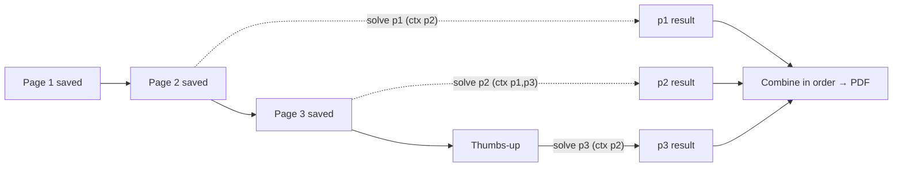

# Glasses Solver: AI handoff and operating guide

Start here when continuing this project. This file records the product intent, current implementation, operating instructions, decisions, and unfinished work; no earlier chat is required.

**Snapshot updated:** 2026-10-19 UTC. **App:** 2.0, build 6, on branch `claude/pensive-allen-ggkllj`, which is based on `solver-app`. **Verified app commit:** see §3; it is the latest commit with green CI. Later documentation commits do not imply a new app build. Recheck the branch and CI before relying on this snapshot.

## 1. Find the right branch and read these files

| Item | Where / purpose |
| --- | --- |
| Active app branch | 2.0 is on [`claude/pensive-allen-ggkllj`](https://github.com/Moh-bukhari/glasses-solver/tree/claude/pensive-allen-ggkllj). 1.3.1 and earlier are on [`solver-app`](https://github.com/Moh-bukhari/glasses-solver/tree/solver-app). Merge or retarget as the user decides. |
| Default GitHub branch | `main`. It holds the upstream Meta sample baseline and pointers to this guide. |
| Earlier draft PR | [Moh-bukhari/glasses-solver#1](https://github.com/Moh-bukhari/glasses-solver/pull/1). Check its current state before continuing. |
| User installation and operation | [SOLVER-SETUP.md](SOLVER-SETUP.md) |
| Repository and SDK instructions | [AGENTS.md](AGENTS.md). The upstream Meta reference follows the Glasses Solver entry point. |
| Lessons from actual failures | [tasks/lessons.md](tasks/lessons.md) |
| **Current acceptance contract** | [tasks/one-button-gesture-spec.md](tasks/one-button-gesture-spec.md) (2.0) |
| Superseded contracts | [tasks/batch-solver-spec.md](tasks/batch-solver-spec.md) (1.3 batch pipeline) and [tasks/auto-scan-spec.md](tasks/auto-scan-spec.md) (single photo) |
| Earlier crash investigation | [tasks/scan-start-crash-spec.md](tasks/scan-start-crash-spec.md) |
| Documentation contract | [tasks/ai-handoff-spec.md](tasks/ai-handoff-spec.md) |

For an existing checkout, inspect its branch and uncommitted work first, fetch the current remote state, and preserve unrelated edits. The repository is derived from Meta's SDK examples, so don't confuse `BirdSpotter`, `DisplayAccess` or generic SDK documentation with this app. The target to develop is `samples/CameraAccess`. BirdSpotter is still a useful reference for Inputs and Motion usage.

## 2. Product goal and decisions to preserve

The user has an **iPhone, a Windows laptop, and Ray-Ban Meta Gen 2 glasses with developer mode** (camera, open-ear speakers, touchpad, capture button, no display). The desired experience:

- Press **one button** and look at each page.
- The app captures each page when it has a good view.
- A **thumbs-up** (or a click on the glasses) finishes.
- One worked-solution PDF arrives on the iPhone **fast**.
- Control is **silent**: gestures and glasses clicks, not voice. The app still gives every instruction needed.
- The user asked for **GPT-6.1 Sol** for OpenAI and **Claude Opus 5.5** for Claude, and doesn't mind which provider is used.

There is no Windows, Raspberry Pi or hosted backend. The iPhone coordinates capture, analyzes images locally, calls the AI APIs directly, and generates the PDF.

Preserve these decisions:

- **Usable photos.** A usable photo shows the complete problem clearly. Don't require a clean background, all four corners, centering, or perspective correction.
- **Readability gates.** Forgiving framing still rejects tiny, distant writing and gross blur or darkness. Never raise the capture rate by weakening the detail check.
- **Directions.** Give specific directions relative to the wearer's camera, then "hold still". Announce the shutter ("Got it"), saved pages, and solving/PDF progress.
- **No voice control.** Controls are on-device hand gestures (thumbs-up = finish, thumbs-down = retake last) and glasses clicks through experimental Meta Inputs, plus the screen. Voice commands stay optional and off by default.
- **Reserved touchpad gestures.** A single tap and tap-and-hold belong to the glasses: they pause/resume and stop the session. Never ask the user to single-tap as a command.
- **Silent audio.** Speech runs at 5% utterance gain through the glasses/Bluetooth route only, by default, using the `.playback` category so the Silent switch doesn't mute it.
- **Speed first.** Solve each page with one streaming request, with its previous and next pages as context, and start while scanning (option "Solve pages while scanning", on by default). This intentionally replaces the 1.3 rule "collect everything, upload only after Finish". The setting restores upload-at-Finish behavior.
- **One provider by default; never a silent downgrade.** Cross-check mode uses both providers and must not quietly fall back when a key is missing or one provider fails.
- **Coverage.** Each page answer includes a checklist of every visible label. Every label is solved or explicitly skipped as belonging to the previous page. Unresolved items show as NEEDS REVIEW. This is not proof of mathematical correctness.
- **No partial PDFs.** A failed page stops PDF creation with page-specific retake or retry instructions. Solved pages stay cached, and a retry re-solves only the failed ones.
- **Draft retention.** Saved pages survive errors, pauses and app restarts, and a replacement never deletes the old photo first. After a successful PDF the draft is cleared; the originals live in the Solutions folder, and the next Start begins a new packet.

## 3. Current status and evidence

| Area | Status at this snapshot |
| --- | --- |
| One-button capture, shutter cue, overlapped still check, per-frame analysis | Implemented; coordinator tests pass in simulator CI |
| Hand gestures (thumbs-up/down) | Implemented. The classifier and timing gate pass 18 fixture tests; coordinator gesture tests pass. Thresholds are untested on real egocentric frames. |
| Glasses buttons (Meta Inputs, experimental) | Implemented. Mapping unit tests pass; a mock-glasses activation test is in the suite. Whether real Gen 2 glasses and this app ID deliver Inputs events is **unverified**. |
| Per-page streaming solving, retries, repair, cache, cross-check | Implemented. The Claude and OpenAI SSE parsers, retry and repair bounds, and request bodies are covered by tests. **No paid live API call has been made.** |
| Default migration to `gpt-6.1-sol` / `claude-opus-5-5` | Implemented and tested |
| PDF | JPEG-backed source previews decoded off the main actor; coverage summary; up to 300 solution pages |
| Physical glasses, real gestures, audio routing, live API latency and accuracy | **Not verified** in the development environment |

Evidence: CI runs from this branch are listed under [Build Glasses Solver IPA](https://github.com/Moh-bukhari/glasses-solver/actions/workflows/build-solver.yml?query=branch%3Aclaude%2Fpensive-allen-ggkllj). Use the latest run where **both** verify and build passed, and check that its head SHA matches the commit you install. The logic-only suites also pass on Linux under Swift 6.3, but that run is supporting evidence only and doesn't replace CI.

History: the user confirmed that 1.x glasses capture and PDF generation worked. They then reported that **"solving" never produced a PDF**. The cause was the latency of a sequential, non-streaming multi-stage pipeline (§6), not a deadlock.

## 4. User workflows

### Setup (Windows, no Mac)

1. Download the `GlassesSolver-IPA` artifact from a green run of the workflow on the 2.0 branch.
2. Install `GlassesSolver-unsigned.ipa` over the existing app with the user's working **iloader**, using the same Apple identity so data and Keychain are kept. Don't prescribe other sideloading tools.
3. Glasses: paired in Meta AI, developer mode on, and camera permission granted when asked. Inputs needs Meta AI V290+ and glasses firmware V128+. It may also be gated per app or user; the app reports this and falls back to gestures.
4. **Auto Scan → Settings**: choose a provider, enter keys, and save. Default models are `gpt-6.1-sol` and `claude-opus-5-5`.

### Scan and solve

1. Tap **Start scanning**. Voice permissions are requested only if Voice commands is on. The camera starts and you hear "Ready".
2. Follow the quiet directions. When the stability gate latches the app says "Hold still"; at the shutter (first transfer byte) it says "Got it" and the wearer may turn the page. After the check you hear "Page N saved".
3. Changed writing re-arms capture automatically. To force it, press the capture button once (next page / take now).
4. Meanwhile, page N−1 is solved in the background as soon as page N is saved. Thumbnails show waiting/queued/solving/solved/failed.
5. Finish with a thumbs-up (held about 1 s), a touchpad double-tap, a capture-button double-press, or **Done · Solve**. To retake the last page: thumbs-down or hold the capture button.
6. Finish solves the last page, plus any page still queued, failed or in flight. The PDF opens automatically, and then the draft is cleared.

### Correct and recover

- **Middle pages.** Pause, then use the queue's **Retake**, **Replace photo** or **Remove**. Only the pages whose context changed are re-solved.
- **Unreadable page.** It stops with "Page N: …"; replace that page and finish again.
- **Transient errors.** Retried automatically, twice. Finishing again re-solves only failed pages.
- **Tab switch or backgrounding.** Stops the camera, never solving. A background-task assertion buys extra time; a suspended request fails and can be retried.

## 5. How the capture workflow works

`AutoScanModel` is the MainActor coordinator. A per-run `runID` invalidates late callbacks.

| Phase | Work / next step |
| --- | --- |
| `idle` | Ready, paused, or imported photos awaiting Finish |
| `connecting` | Optionally prepare voice, wait for the device, request camera permission, start the SDK camera |
| `seeking` | Analyze preview frames (every frame, one in flight) for stability, framing and gestures |
| `capturing` | Request the full still; `onShutter` fires on the first transfer byte |
| `checking` | Check and save the still while the preview restarts in parallel |
| `awaitingNext` | Wait for a changed page, the capture button, or a finish gesture |
| `solving` | Wait for the remaining page jobs |
| `saving` | Combine results and write the PDF and originals |
| `finished` | PDF presented; draft cleared |
| `failed` | Actionable error; pages and cached page results retained |

`AutoScanCamera` owns the Meta SDK `DeviceSession`, `Camera`, `Stream`, `Photo` and `Inputs`:

- **Preview:** raw/high at 7 fps.
- **Full photo:** stream stop → `photo.start` → `capturePhoto(.full, .high)` → transfer → `photo.stop`. A stream-photo fallback is used only for `serviceUnavailable`/`sessionSetupFailed`.
- **Photo filter:** only photos the app requested are accepted, so the wearer's own shutter photos are ignored.
- **Inputs:** attached on the first preview frame, and re-attached on the next frame after a full photo deactivates them (behavior seen in BirdSpotter).
- **Waits:** pause-aware. Time paused from the glasses, up to 120 s, doesn't count. A session `dwaOutOfStuRange` error is a notice, not a failure.

`PageAnalyzer` runs Vision text-rectangle detection (no OCR) and, for preview frames only, `VNDetectHumanHandPoseRequest`. Hand detection runs in a separate `perform`, so a hand-model failure can't lose text results. `HandGestureClassifier` and `GestureGate` live in `HandGestures.swift`.

Tuning values:

| Gate | Current behavior |
| --- | --- |
| Preview analysis | Every frame (≥0.12 s apart), one analysis in flight |
| Close-up | Median text line ≥10 px at full resolution; region too small when width <0.18 **and** height <0.14 |
| Gross quality veto | Luminance <0.07, contrast <0.018, or sharpness <0.00012 |
| Stable hold | 1.0 s only when clearly readable (cue hold, sharpness ≥0.0005, contrast ≥0.036, line ≥14 px). Otherwise 1.5 s with a hold cue, or 3 s; at least 5 samples. |
| Still check | Stills with a long edge ≥2000 px are checked at half size, but only when text is found, the view is acceptable, and the line is ≥20 px. Otherwise the exact full-resolution check runs. Original JPEG bytes are kept. |
| Page turn | ≥2 s after the latch, then 3 changed usable frames spanning ≥0.4 s, with no command hand. Thresholds: content fingerprint 0.065, full-frame fallback 0.20 |
| Gestures | Palm ≥15% of the short side, joints away from edges, fist plus straight thumb within 40° of vertical, clear of the fingers. Fires after 4 consecutive analyses spanning ≥0.9 s, then a 2 s cooldown and a release. A raised command hand resets the capture hold. |
| Unclear stills | Never end a hands-free run; the app keeps guiding. Three consecutive transfer failures stop with pages kept. |

These are heuristics. Tune them against real photos and logs, not by guessing.

## 6. What the AI does

### Why 1.3 "never finished"

1.3.x ran an inventory request, a second-provider audit, and then for each group of six subparts two solves followed by a reconcile. All requests were sequential and non-streaming, and each re-sent every photo, with a 16k token cap and a 24k repair. A 3–6 page packet took 10–45 minutes and could hit the 300 s idle / 360 s total URLSession limits. Tab switches also cancelled it.

### 2.0 per-page pipeline



**Job plan and caching**

- `PagePlan.keys` defines one job per page, keyed by page, previous, next, last, and provider setup.
- While scanning, the newest page waits until its successor exists. Finish adds the last page.
- Results are cached by key, so a retake or removal re-solves only pages whose context changed. When a page is renumbered, its results shift their `sourcePages`.

**Request**

- One request per page, with labeled images (PREVIOUS context / PRIMARY / NEXT context) and the page task.
- The page solves every item that **begins** on it, using the next page for continuations. Items that began on the previous page, or a repeated or overlapping photo of it, go into `skipped`.
- Output schema (strict; all fields required): `readable`, `retake`, `title`, `checklist[]`, `solutions[{label, problem, steps[], answer, check, status, reviewNote, sourcePages[]}]`, `skipped[{label, reason}]`.

**Validation and repair**

- An unreadable page throws page-specific retake instructions; it is never repaired.
- Labels must be unique. Every answer needs non-empty steps, an answer and a check. Any status other than solved needs a note.
- Every checklist label must be either solved or skipped.
- One repair is allowed, raising the token limit from 32k to 48k.

**Cross-check mode**

- Lead and peer solve in parallel; then the lead reconciles both drafts against the photos.
- The reconciled answer must cover every label either draft solved.

**Retries and concurrency**

- Retries are capped at two, with backoff of 2 s and 6 s, or `retry-after` clamped to 1–20 s.
- Retried: HTTP 408/409/429/5xx/529, SSE error events, a stream that ends early, and `URLError` timeouts or lost connections.
- Never retried: 400/401/402/403/404/413, spend-cap or insufficient-quota 429s, and refusals.
- `AsyncLimiter` allows at most 4 concurrent provider requests.

**Combine**

- Results are joined in page order, and a repeated label+problem is kept once.
- The coverage line counts pages, items and NEEDS REVIEW flags. With no items at all, combine fails.

### Provider transport

| Item | Current implementation |
| --- | --- |
| Claude | `POST https://api.anthropic.com/v1/messages`, `stream: true`, `x-api-key`, `anthropic-version: 2023-06-01`. `output_config: {format: json_schema, effort: "medium"}` (effort is sent only to `claude-*-5*` models). Thinking is adaptive by default. `max_tokens` 32000, repair 48000. |
| OpenAI | `POST https://api.openai.com/v1/responses`, `stream: true`, `stream_options.include_obfuscation: false`, `store: false`. `reasoning.effort: "medium"` for gpt-5/6/o3/o4. `text.format` is a strict json_schema. `max_output_tokens` 32000, repair 48000. Image detail high. |
| SSE parsing | `StreamParser`. Claude: text deltas of text blocks, `message_delta.stop_reason`, `message_stop`. OpenAI: `response.output_text.delta` plus the final `response.completed/incomplete/failed` object. Both rebuild the non-stream envelope for `SolverClient.payload`. |
| Timeouts | URLSession idle 240 s, resource 900 s |
| Upload copies | ≤2200 px long edge, ≤1.5 MB JPEG, cached per file URL in `PageSolver` |
| Defaults | `gpt-6.1-sol` (GPT-6.1 Sol) and `claude-opus-5-5`. Editable model IDs. Account access is not guaranteed. |

Verify vendor documentation before changing endpoints, parameters or model IDs. Research notes from 2026-10-19 cover the facts used: streaming events, effort, structured outputs, vision limits, and the `gpt-6.1-sol` identification.

## 7. Code map and ownership

All paths are relative to the repository root.

| File | Responsibility / key types |
| --- | --- |
| [CameraAccessApp.swift](samples/CameraAccess/CameraAccess/CameraAccessApp.swift) | App entry; `Wearables.configure()`; debug mock support |
| [MainAppView.swift](samples/CameraAccess/CameraAccess/Views/MainAppView.swift) | Auto Scan / Glasses / PDFs tabs |
| [AutoScanView.swift](samples/CameraAccess/CameraAccess/Solver/AutoScanView.swift) | One-button controls, `ScanViewfinder`, `PageQueueView` with solve badges, settings sheet, lifecycle hooks; `SolutionViewer`, `PDFPreview`, `SolutionHistoryView` |
| [AutoScanModel.swift](samples/CameraAccess/CameraAccess/Solver/AutoScanModel.swift) | Capture state machine, gesture/glasses/screen command handling, page jobs (`syncJobs`, `startJob`, `advanceFinish`), PDF save, cues |
| [AutoScanCamera.swift](samples/CameraAccess/CameraAccess/Solver/AutoScanCamera.swift) | `ScanCamera`, SDK lifecycle, full still transfer, Inputs attach/re-attach, `ScanCommand.glasses(_:)` mapping, pause-aware waits |
| [ScanQuality.swift](samples/CameraAccess/CameraAccess/Solver/ScanQuality.swift) | `PageAnalyzer` (text and hand pose), `PageSample`, `ContentFraming`, `StabilityGate`, `PageTurnGate`, `GuidanceSpeechGate` |
| [HandGestures.swift](samples/CameraAccess/CameraAccess/Solver/HandGestures.swift) | `HandGestureClassifier`, `GestureGate`, `HandPoseVision` adapter |
| [PageSolver.swift](samples/CameraAccess/CameraAccess/Solver/PageSolver.swift) | `PageJobKey`, `PagePlan`, `PageResult` validation, `PageSolver` (retries, repair, cross-check), `AsyncLimiter` |
| [BatchSolver.swift](samples/CameraAccess/CameraAccess/Solver/BatchSolver.swift) | Provider config and defaults, `AIServiceError`, `SolverClient` (request bodies, schema, instructions, streaming), `StreamParser` |
| [ScanVoice.swift](samples/CameraAccess/CameraAccess/Solver/ScanVoice.swift) | Quiet speech, `.playback` output, private-route guard, optional on-device voice commands |
| [ScanDraft.swift](samples/CameraAccess/CameraAccess/Solver/ScanDraft.swift) | `CapturedPage`, `ScanDraftStore` |
| [SolverService.swift](samples/CameraAccess/CameraAccess/Solver/SolverService.swift) | Result types, async `SolutionStore`, `SolutionPDF` |
| [SolverView.swift](samples/CameraAccess/CameraAccess/Views/SolverView.swift) | `SolverKeychain` (with `migrateDefaults`), settings |
| [project.pbxproj](samples/CameraAccess/CameraAccess.xcodeproj/project.pbxproj) | Explicit app sources; Meta products (Core, Camera, MockDevice, **Inputs**) linked by `productRef` |
| Tests | `AutoScanTests` (capture, coordinator, Meta mock, PDF, voice), `PageSolvingTests` (plan, combine, validation, SSE, retries, requests, migration), `HandGestureTests`, `GlassesInputTests` |
| [build-solver.yml](.github/workflows/build-solver.yml) | CI tests and unsigned Release IPA |

New app Swift files must be added to the Sources phase. The test folder is synchronized automatically. In the test target, `MemberImportVisibility` is on, so import every module whose members a test uses. `MWDATMockDevice` redeclares the Inputs enums, so keep the `MWDATInputs` mapping tests in a file that doesn't import the mock.

## 8. Data, credentials and PDF behavior

| Data | Location / behavior |
| --- | --- |
| Draft | `Documents/ScanDraft/pages.json` plus `<UUID>.jpg`. Atomic writes; a replacement is written before the old photo is deleted. Cleared after a successful PDF. |
| Finished packet | `Documents/Solutions/<UUID>/Solution.pdf`, `Solution.json`, `Paper.jpg`, `Paper-2.jpg`, … (originals copied) |
| Keys | Keychain service `GlassesSolver`, accounts `OpenAI` and `Anthropic`, `WhenUnlockedThisDeviceOnly` |
| Preferences | `solverMode`, `solverModel`, `claudeModel`, `settingsVersion` (2 = migrated), `solveWhileScanning`, `handGestures`, `glassesButtons`, `voiceCommands` (default off), `voiceGuidance`, `privateAudio`, `cueVolume` |

- Each key goes only to its own provider.
- When solving while scanning is on, pages are uploaded during the scan; with it off, nothing is uploaded until Finish.
- Gesture detection and speech stay on the device. `store: false` is not a blanket retention guarantee.
- The PDF contains a coverage summary, every solution with source pages and review flags, and all source photos as 1600 px JPEG previews.

## 9. Build, test and distribute

The project uses **Meta SDK exact 1.0.1**, Swift 6.0 language mode, and minimum iOS 17.2. CI runs on macOS 26 with Xcode 26.4 and the **iPhone 17 Pro / iOS 26.4.1** simulator.

Test command (from the repository root; the workflow is the source of truth):

```bash
xcodebuild test -project samples/CameraAccess/CameraAccess.xcodeproj -scheme SolverTests -configuration Debug \
  -destination 'platform=iOS Simulator,name=iPhone 17 Pro,OS=26.4.1' \
  -only-testing:CameraAccessTests/AutoScanTests -only-testing:CameraAccessTests/PageSolvingTests \
  -only-testing:CameraAccessTests/HandGestureTests -only-testing:CameraAccessTests/GlassesInputTests \
  -parallel-testing-enabled NO -resultBundlePath TestResults.xcresult \
  -test-timeouts-enabled YES -default-test-execution-time-allowance 90 \
  CODE_SIGN_IDENTITY="-" CODE_SIGNING_ALLOWED=YES CODE_SIGNING_REQUIRED=YES DEVELOPMENT_TEAM=""
```

- Simulator tests need ad-hoc signing, because Meta initializes a Keychain access group.
- The unsigned device build and IPA packaging are unchanged; see the workflow.
- Keep bundle ID `com.mohbukhari.glassessolver`.
- **CI triggers:** a push to `solver-app` touching the app or the workflow, or a manual `workflow_dispatch` on any branch. 2.0 was verified through `workflow_dispatch` on its branch.
- **No Xcode?** A Linux container can still type-check and unit-test the Foundation-only files (`BatchSolver`, `PageSolver`, `HandGestures`) with a Swift toolchain plus small stubs for `URLSession.bytes`, `uploadPhoto` and the `SolvedPage` types. That is useful before CI, but not a substitute for it.
- **Not validated by tests:** paid APIs, real optics, real hands, Bluetooth audio, and real Inputs availability.

## 10. Troubleshooting and unresolved work

| Symptom | Where to investigate / next useful evidence |
| --- | --- |
| Still slow | Look at per-page states. A page stuck on "solving" points to provider latency, so check the effort and model. Cross-check mode doubles the rounds. Consider `speed: "fast"` (Claude) or `service_tier` (OpenAI) only after measuring. |
| HTTP 400 on the first request | Check the model ID, and for Claude 5 whether the account accepts `output_config.effort`. Compare against vendor docs. |
| Thumbs-up not recognized | Log `HandGestureClassifier.evaluate` rejection reasons (palmSize, nearEdge, noMatch) on real frames. Check that the preview orientation is upright. Tune the thresholds in `HandGestureClassifier.Thresholds`. |
| False gestures while holding paper | Raise `minPalm` or `thumbClearance` using logged real frames. The gate already needs about 1 s and a release. |
| "Glasses buttons are unavailable" | Inputs is experimental and may be gated. Check Meta AI and firmware versions and Developer Center; gestures and the screen still work. |
| Capture button also takes a native photo | The unrequested photo is ignored by `photoRequested`. Whether a subscribed button suppresses the system photo needs a device check. |
| Scanning paused | The wearer single-tapped (the glasses' pause). Tap again to continue; waits are pause-aware up to 2 minutes. |
| Same page captured twice | Page-turn heuristics. The AI also skips repeated questions via the previous-page context, and combine dedupes the same label and problem. |
| Partial or empty answer | Check the page checklist, skipped reasons, and the repair attempt. An unreadable page names its page. |

Next priorities, **not completed claims**:

1. Run a device test of 2.0: one-button start, quiet directions through the glasses, the shutter cue, a 3–5 page packet, thumbs-up finish, and the PDF arriving about one page-solve after the gesture.
2. A real-API run with a small known-answer packet on each provider. Measure per-page latency and check continuation and skip handling across a question that spans pages.
3. Check Inputs on Gen 2: activation, double-tap and capture-button events, and whether a capture press also takes a system photo.
4. Calibrate the gesture thresholds and the quick-hold and half-size still-check gates from logged real frames.

## 11. How the next AI should work and leave a handoff

1. Read this guide, the current spec and the lessons; inspect the code, branch and status. The latest user request and actual evidence determine the task.
2. For substantial changes, write or update a short acceptance spec, then verify behavior (CI and, where needed, device), not merely compilation.
3. Keep keys, Apple credentials, personal paper images and tokens out of source, docs and logs. Run paid live tests only when the user's task authorizes them.
4. Before calling a release ready, record the exact commit, version/build, CI link, test counts, artifact, and what still needs hardware or API confirmation.
5. Update this guide's snapshot, workflows, limits, code map and next priorities after changes; keep SOLVER-SETUP aligned; add a lesson when user feedback reveals an incorrect assumption.
6. Keep the `main` entry points pointing at this guide, and keep AGENTS and CLAUDE as entry points rather than competing copies.

Primary references: [Meta developer docs](https://wearables.developer.meta.com/docs/develop/) (Inputs: `/docs/develop/dat/inputs`), [bundled Meta skills](plugins/mwdat-ios/skills), [Claude streaming](https://platform.claude.com/docs/en/build-with-claude/streaming), [Claude structured outputs](https://platform.claude.com/docs/en/build-with-claude/structured-outputs), [Claude effort](https://platform.claude.com/docs/en/build-with-claude/effort), [OpenAI streaming events](https://developers.openai.com/api/reference/resources/responses/streaming-events), [OpenAI GPT-6.1 Sol](https://developers.openai.com/api/docs/models/gpt-6.1-sol), [Apple hand pose](https://developer.apple.com/documentation/vision/vndetecthumanhandposerequest).
